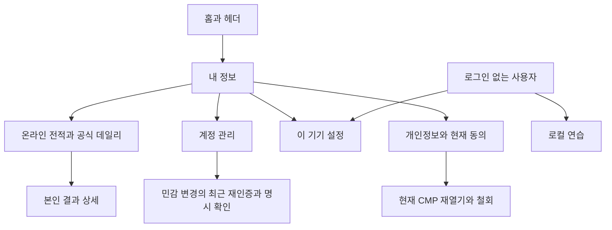

# ADR0081 · 내 정보 화면과 파일 다운로드 제거

- 상태: 채택 — 2026-11-01 사용자 요청과 후속 선택에 따른 설계 변경
- 작업: #176 설계 → #177 본인 조회 API → #178 화면 전환·다운로드 제거
- 선행: #174/PR175 병합·종료, develop `be9015e159212073e2d3341171da976805879f65`
- 추적: FR01/09/11/13/16 · NFR01/02/05/06/07/08 · TS17~22/24/26/29/34~36
- 근거: [사용자 지시 기록](../workflow/approval-record.md)

## 문제와 결정

사용자는 전적·계정·설정을 웹 화면에서 확인하려 한다. 현재 설정에는 계정 관리가 있고 `/results`는 최근 온라인 결과 한 건만 제공한다. 데이터 파일 다운로드는 일상적인 조회 화면을 대체하지 못한다. 사용자는 별도 질문에서 파일 다운로드 기능 제거를 명시적으로 선택했다.

`내 정보`를 본인 계정과 전적의 진입점으로 추가한다. 파일 다운로드는 보조 메뉴에도 남기지 않고 UI·일괄 수집기·공개 export API에서 제거한다. 본인 데이터의 화면 열람·설정 변경·연결 해제·동의 철회·계정 삭제는 유지한다. 기존 저장 자료의 조회 방식이 바뀌며 개인정보 항목이나 보존 기간을 늘리지 않는다.

이 문서는 목표 설계다. #176은 문서 변경이며 현재 실행 코드에서 다운로드를 이미 제거했다고 표현하지 않는다. 실제 전환은 #177과 #178의 검증·병합 후 완료한다. 과거 구현과 실행 근거는 이력으로 보존한다.

## 화면 구성

| 경로 | 사용자가 확인하거나 실행할 내용 |
|---|---|
| `/{locale}/me` | 닉네임·연결 제공자 요약, 보관 기간 안의 온라인 전적 요약, 최근 기록, 계정·설정·개인정보로 이동 |
| `/{locale}/me/history` | 온라인 대전과 공식 데일리의 최신순 목록·페이지 이동·해당 기록 상세 |
| `/{locale}/me/account` | 닉네임 변경, OAuth 연결·해제, 로그아웃, 명시 확인을 거친 계정 삭제 |
| `/{locale}/me/privacy` | 현재 분석/광고 선택, 확인·만료 상태, CMP 재열기·철회, 저장 항목·보존 기간 안내 |
| `/{locale}/settings` | 언어·모션·대비·확대, 공개 캐시·기기 기록 관리, 기기 CMP 재열기·철회. 로그인 없이도 사용 가능 |

홈과 헤더의 계정 영역에서 `내 정보`로 이동한다. 내 정보의 `설정` 링크는 기존 `/settings`와 같은 PreferencesPort·공통 컴포넌트를 사용한다. 계정 설정과 이 기기 설정의 저장 범위를 화면에 명시한다. 언어·접근성 값을 새 계정 DB 필드로 복제하거나 기기 간 동기화를 약속하지 않는다.

로그인 없는 사용자도 공통 설정과 footer에서 CMP 선택을 다시 열고 철회할 수 있다. 기기 CMP 제어는 같은 ConsentPort·공통 컴포넌트를 재사용하고, `/me/privacy`의 서버 현재 동의 설명과 구분한다. 내 정보 도입을 이유로 익명 사용자의 동의 제어에 로그인을 요구하지 않는다.

기존 `/results`의 최신 결과 발견·서버 재시작 복구는 유지한다. 결과와 내 정보 간 이동을 연결하되 현재 대전에 재입장하거나 승패를 재판정하지 않는다. 기존 `/daily`의 로컬 기록·공식 도전과 공유는 유지한다. 닉네임 없는 인증 사용자도 본인 계정·동의·삭제에 접근하며, 대전 시작에만 기존 닉네임 조건을 적용한다.

## 전적의 의미와 보존 범위

기본 범위는 조회 시점의 **최근 90일 중 서버에 보관된 본인 기록**이다. 같은 기간·종류 필터에 대한 서버 요약을 사용하며 현재 페이지의 합계를 전체 전적으로 표시하지 않는다. 평생 전적·영구 누적 카운터를 새로 저장하지 않는다. 조회 기준 시각·범위와 실제 갱신 시점을 보여준다.

| 항목 | 표시·집계 기준 |
|---|---|
| 온라인 전적 | 승·패·무승부를 구분한다. 완료된 승/패/무승부만 경기 수에 포함하고 승률은 `승 / (승 + 패 + 무승부)`다. 표본0이면 승률은 없음이다. Rust가 계산한다. |
| 이탈·양쪽 연결 종료 | 기존 `forfeit`·`abandoned` 판정을 그대로 표시하고 기존 completed 결과의 승패/무승부에 포함한다. 결과 이유를 숨기지 않는다. |
| 장애 취소·시작 전 취소 | abort/cancelled 수와 이유를 별도 표시하고 경기 수·승률 분모에서 제외한다. |
| 사람·봇 | 실제 저장 자료로 확인한 상대 종류만 사용한다. 상대 계정 삭제 등으로 종류를 확인할 수 없으면 별도 ‘확인 불가’로 표시하고 모두 보기에 포함한다. 사람/봇 필터에는 해당 종류가 확인된 기록만 포함한다. 봇 전적을 사람 전적으로 제시하거나 종류를 추정하지 않는다. 상대 식별자·닉네임은 새로 수집하지 않는다. |
| 공식 데일리 | UTC 날짜, 첫 검증 완료, 실수와 저장된 신뢰 수준을 표시한다. nullable 서버 시간과 로컬 replay 시간은 기존 의미를 유지한다. |
| 이 기기 연습 | 기존에 이 기기에 저장한 데일리 연습 기록만 별도 출처로 안내한다. 공식 전적에 합치거나 로그인 때 서버로 자동 업로드하지 않는다. 저장하지 않은 봇 연습 이력을 만들지 않는다. |
| 확인 불가 통계 | 기존 `own:null`·시간 null은 확인 불가로 표시한다. 0·분모·상대 정보·현재 rules를 추정해서 채우지 않는다. |

목록은 한 번에 최대20개를 최신순으로 읽는다. 온라인 순서는 기존 latest의 `(retention anchor, recorded_at, UUID)` 내림차순을 따른다. 데일리는 `(completed_at, UUID)` 내림차순이다. 서버가 발급한 정렬 cursor를 다음 POST 본문에 보내며 cursor는 조회 권한이 아니다. 모든 페이지에서 본인·종류·보존 기간을 다시 검사한다. cursor를 조작해도 다른 사람 기록은 반환하지 않는다. 여러 요청 전체가 같은 DB snapshot이라고 보장하지 않는다.

## 본인 조회 API와 권한

새 `POST /api/v1/me/overview`와 `POST /api/v1/me/history`는 #177에서 Rust 원천 DTO·strict decode·생성 TS로 정의한다. overview 입력은 닫힌 v1, history는 v1·허용 종류 필터·선택 cursor뿐이다. account ID·닉네임·임의 기간·무제한 limit를 조회 대상 선택자로 받지 않는다. 본인은 서버 쿠키 세션에서 결정한다. 사용자 식별자·cursor를 URL/query에 넣지 않는다.

일반 화면 조회는 현재 유효 세션·Origin·CSRF·응답 전후 동일 세션을 확인한다. 조회할 때마다 OAuth 재로그인을 요구하지 않는다. 연결/해제·삭제 등 민감 변경은 기존 최근300초 재인증과 명시 확인을 유지한다. 요청 전체2초·bounded 동시/rate·SQL binding과 account→session 잠금 순서를 따른다. 새 reader는 SRP/DIP를 유지하고 기존 저장 결과·데일리·계정/동의 저장소의 권한·보존 검사를 재사용한다.

계정 전환·로그아웃·삭제·세션 철회·오프라인 때 개인 화면의 진행 요청을 취소하고 데이터를 즉시 숨긴다. 늦은 응답은 화면을 복원하지 못한다. 개인 응답은 no-store, 화면은 noindex다. 공개 shell/WASM 캐시는 유지하되 계정/전적 API·개인 snapshot을 SW/localStorage/IndexedDB에 저장하지 않는다. 로그인 없는 `/me`는 로그인 안내이며 로컬 계정을 생성하지 않는다. 빈 전적·읽기 실패·만료 세션·손상 자료는 각각 구분한다.

동의 화면은 현재 목적별 선택과 만료·미설정 상태를 설명하는 view다. #174의 저장 view나 브라우저 boolean이 선택 이벤트 저장 권한을 대신하지 않는다. 실제 CMP 미설정은 미설정으로 표시하고 기본 차단한다. 실제 변경은 기존 CMP port와 서버 검증·revision/철회 경계를 연결한 뒤 제공한다. 이 화면을 위해 과거 모든 동의 이력이나 새 개인정보를 저장하지 않는다.

## 파일 다운로드 제거와 기존 코드 처리

#178은 새 조회 화면 연결과 기존 다운로드 제거를 같은 PR에서 처리한다. 버튼만 감추고 공개 bulk API를 남기는 방식은 완료가 아니다.

- `내 데이터 내려받기`, `liar-account.json`, 계정 JSON Blob/download sink와 일괄 collector를 제거한다.
- AuthPort/transport의 파일 export 동작과 PersonalDataExport·게임 export/replay 전용 DTO·관련 생성 TS를 제거하거나 본인 조회용 최소 DTO로 전환한다.
- `/api/v1/me/export`, `/api/v1/me/games/export`, `/api/v1/me/games/replay`는 등록을 제거하고 본인 자료를 반환하지 않는404로 닫는다. 비활성 경로의503도 제거 대상이다.
- 파일 전용 raw replay 제공 경로는 제거한다. 공식 replay 저장·검증·보존 정리, 필수 이벤트 수집, 본인 기록의 화면 조회와 계정 삭제는 유지한다.
- 기존 migration·서버 데이터·design_layout 원본·실행 검증 기록은 보존한다. 새 전적을 위해 과거 데이터나 알 수 없는 통계를 역산하지 않는다.
- 데일리 결과 공유 카드·PNG는 개인정보 일괄 파일 다운로드와 다른 기존 게임 기능이며 이번 제거 대상이 아니다. 운영 DB 백업·복구도 기존 운영 범위다.

ADR0021/0022/0053/0056/0064/0080 등의 파일 export 요구와 ‘동의 내보내기를 다음으로 구현’하는 계획은 이 결정의 해당 범위에서 대체한다. 계정 소유권·재인증·철회·최소 수집·삭제·보존·공정성 원칙은 유지한다. 실제 운영 정책의 외부 검수 #147과 #83의 업데이트 복구는 별도 출구다. 내부망 admin이나 전역403/404 전용 화면은 이번 내 정보 설계에 포함하지 않는다.

## 구현 순서와 인수

1. **#176 설계 변경:** 사용자 방향·PRD·화면·권한·시나리오·백로그를 일치시키고 검증 후 develop에 병합한다.
2. **#177 본인 조회 API:** overview/history·기간별 요약·현재 계정/동의 view·페이지·권한을 실제 PG/HTTP로 검증한다. 아직 기존 UI가 사용하는 파일 API를 먼저 끊지 않는다.
3. **#178 화면 전환·제거:** 새 내 정보를 연결하면서 다운로드 UI/API/DTO/테스트를 원자적으로 전환한다. 최신6checks와 정확 head를 확인해 병합하고 제거 완료를 확인한다.

시나리오→Red 실행→Green→Refactor를 따른다. 기간/정렬/필터/분모·0표본/null·20개 경계·타인/cursor 조작·세션 전환/삭제/역순 응답·90일 exact expiry·no-store/noindex·원래 게임/데일리/공유 회귀를 검증한다. 실제 HTTPS의8언어·360px/PC·키보드에서 내 정보 조회와 다운로드0, 세 구 export API404를 검사한다. 새 Rust 도메인은95%, 서버 전체80% gate에 포함한다. 설계 검토 통과를 제품 구현·실제 OAuth/CMP 검수 완료로 보고하지 않는다.
