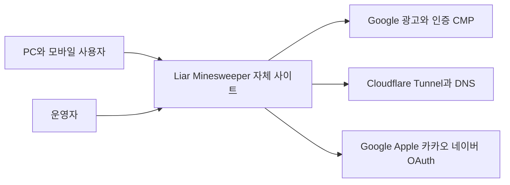
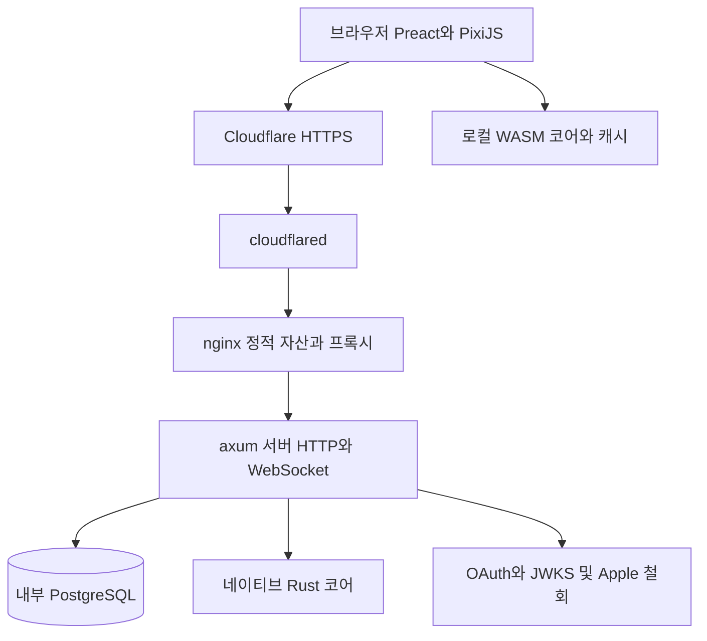
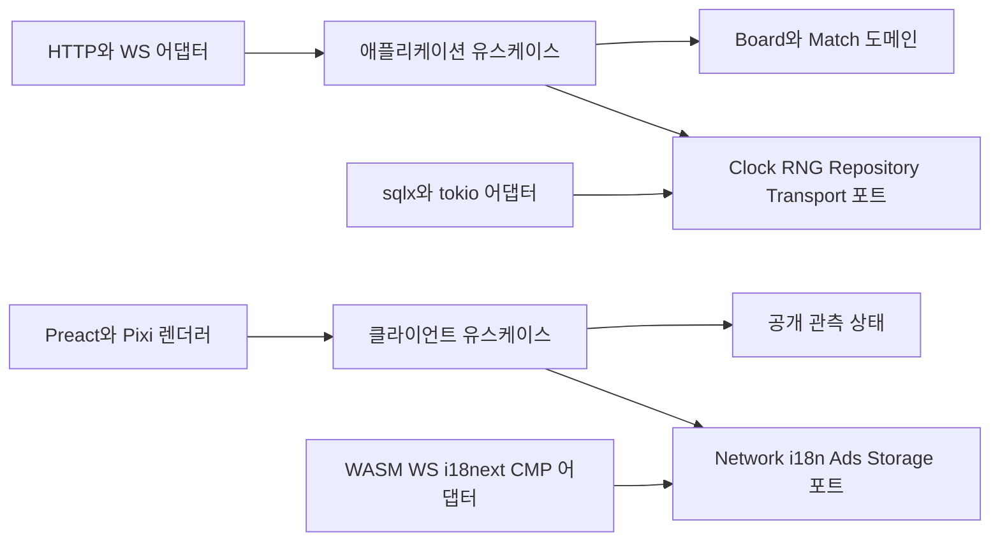

# 01. 시스템 아키텍처

> 현행 구조 · 대응: FR01~16, NFR01/02/07 · [PRD](../product/16-PRD.md) · [초기 대비 변경과 남은 출구](19-design-evolution.md)

## C4: 시스템 컨텍스트

사용자는 자체 사이트에서 로컬 연습 또는 최소 OAuth 로그인을 선택한다. 인증된 온라인 대전·공식 기록은 자체 서버가 처리하며, 제공자 code/token 교환·검증은 서버의 provider port가 맡는다. 비밀번호·불필요한 제공자 프로필을 보관하지 않는다. 운영자는 가정 미니 PC를 관리한다. 외부 결제·분석 SaaS·클라우드 게임 서버는 없다.

## C4: 컨테이너

HTTP/WS는 동일 origin에서 제공한다. 온라인 정답은 서버만 보유한다. WASM은 공개 데일리·로컬 봇 규칙을 실행하며 온라인 숨은 판을 재생성할 자료를 받지 않는다. 오프라인과 온라인 데이터를 타입 수준에서 구분한다.

## 브라우저의 공개·보호 문서 경계

Google 모드의 공개 홈/규칙/동의 관리 문서만 단일 shared client로 태그를 준비한다. 준비 전 광고 요청을 pause하고 현재 광고 선택을 확인한 홈/규칙에서만 재개한다. 태그를 시작한 문서에서 게임·개인·인증으로 갈 때는 새 문서 탐색으로 실행 SDK를 격리한다. 공개 동의 관리에서도 광고 요청은 하지 않는다. [ADR0107](../adr/0107-google-cmp-bootstrap.md)·[11 동의](11-ads-consent.md)를 따른다.

자체 선택 분석/광고 측정은 브라우저 광고 선택과 별도다. 현재 로그인에서 명시 반영한 선택을 서버 세션·revision·만료와 함께 검증하고 저장 transaction에서 다시 확인한다. 브라우저 TC string은 외부 서명 인증이나 계정 권한이 아니다([ADR0109](../adr/0109-current-session-google-consent-evidence.md)).

## C4: 컴포넌트와 의존성

도메인은 시간·DB·WebSocket·렌더러를 import하지 않는다. 애플리케이션이 도메인과 추상 포트를 사용하고 composition root가 구현체를 주입한다. Rust의 trait, TypeScript의 interface/서비스로 의존성 역전을 구현한다. 계층의 호출 흐름과 소스 의존 방향을 혼동하지 않는다.

## 프로세스 경계

서버는 하나의 프로세스, 매치당 직렬 mailbox로 명령을 처리한다. 생성/증명은 bounded blocking pool에 격리하고 미리 검증한 판을 풀로 준비한다. DB는 매 클릭 경로 밖에서 결과를 transaction으로 저장한다. 연결 수·큐·매치 수에 상한을 두며 부하 초과 시 새 입장을 거절한다.

설정·도메인·프로토콜 타입의 원천은 Rust다. 클라이언트 온라인 코드는 시각·입력만 담당하고 승패를 예측해서 확정하지 않는다. 도메인 오류는 안정된 code로 전달하고 문구 번역은 클라이언트가 한다.

온라인 저장소는 단일 journal owner가 소유한다. 정상 종료는 새 매칭 차단 뒤 기존 판/저장을 drain하고, 비정상 재시작은 journal의 중단 판을 abort로 정리한다. 백업 복원은 별도 quarantine gate와 최신 권리 원장/원본 차단을 거쳐야 한다. 일반 프로세스 재시작과 백업 복원을 같은 복구로 취급하지 않는다([16 운영](16-observability-ops.md)).
