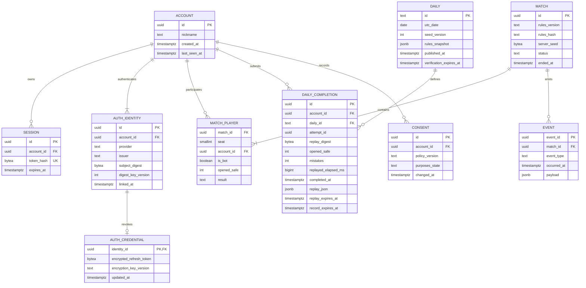

# 07. PostgreSQL 모델

> 2026-11-01 [ADR0081](../adr/0081-my-info-and-export-removal.md): 본인 기록의 표시를 내 정보 조회로 전환하고 파일 export를 제거한다. 기존90일/원시 보존·동의 현재1행·계정/세션 cascade는 유지한다. 전적을 위해 새 영구 누적·개인정보나 동의 이력을 추가하지 않는다.

#82의 [ADR0039](../adr/0039-authenticated-personal-result-read.md)은 ResultReader/Pg의 account+match 참여 조건과90일 미만 조회, 중복 seat/오염 fail-closed를 정의한다. seed를 선택하지 않으며 삭제 참여 행/없는 결과/다른 계정은 같은404다. 기존 migration과 저장 retry의 삭제 비복원 계약을 유지한다. 물리 정리 #25는 별도 출구다.

#16의 [ADR0023](../adr/0023-authoritative-match-actor.md)은 `online_match_results`의 match UUID unique·rules hash·서버 전용8byte seed·종료 elapsed/reason/저장 시각과 `online_match_players`의 seat0/1·account FK cascade(봇은 null)·최종 outcome/집계를 별도 transaction에 저장한다. 닉네임/세션/identity는 복사하지 않는다. 계정 삭제는 참여 행을 제거하고 식별자 없는 매치 부모만 남긴다. 저장 전에 account key-share lock으로 존재를 확인하며 이미 삭제된 인간의 참여 행은 생성하지 않는다. 중복 부모는 참여 행을 재삽입하지 않으므로 삭제된 개인정보를 retry로 복원하지 않는다. 이전 migration checksum은 바꾸지 않는다.

#44는 별도 migration `202610080002_auth_locale.sql`로 기존 인증 거래에 8locale allowlist를 추가한다. 기존 migration checksum을 바꾸지 않고 en을 기본값으로 보존한다. public session_revision은 기존 auth_sessions.id를 조회하며 새 secret/개인정보 컬럼이 아니다. [ADR0020](../adr/0020-oauth-providers-and-http.md).

> 대응: FR01/09/14/16 · DB 구현·migration은 M3에서 작성한다.

## 제약과 인덱스

- MATCH_PLAYER PK=(match_id, seat), seat 0/1, account null은 bot 또는 삭제된 신원에 한정; bot flag·account 유효성 check.
- AUTH_IDENTITY unique(provider,issuer,subject_digest,digest_key_version); 모든 기존 key version 조회와 재해시를 transaction으로 처리한다. 현재 digest 기준 advisory lock과 회전 중 쓰기 중지로 서로 다른 key version의 중복 연결도 막는다. 원문 subject·이메일·password 컬럼 없음.
- AUTH_CREDENTIAL은 Apple 철회용만, AEAD+AAD와 외부 key vault, identity 삭제 시 목적 제한 revoke queue 후 제거. 일반 provider token 장기 저장 없음.
- SESSION token_hash unique, account_id와 expires_at 인덱스; 원문 토큰 저장 금지.
- DAILY는 #112의 daily_definitions이며 canonical metadata.id text PK와 unique(utc_date,seed_version)를 사용한다. 실제 rules_snapshot을 immutable로 보존하고 metadata/공개 seed는 같은 Rust로 유도한다. 같은 날짜의 다른 proposal보다 committed snapshot이 권위다.
- DAILY_COMPLETION은 daily_completions이며 unique(account_id,daily_id)와 unique(account_id,attempt_id)를 사용한다. 실패·후속 연습 로그는 쌓지 않는다. 기존 auth account→session 잠금/unique/commit으로 첫 완료 한 건을 확정하며 account FK cascade 삭제 후 retry로 복원하지 않는다. 같은 canonical digest 재시도만 원래 receipt를 반환한다.
- replayed_elapsed_ms는 비신뢰 개인 참고값이다. 실제 server ticket/heartbeat·verified_time/완료 두 순위와 인덱스는 다음 #19 하위에서 별도 구현한다. #112가 공식 시간이나 순위까지 구현한 것으로 계산하지 않는다.
- MATCH(status, ended_at), EVENT(occurred_at,event_type), CONSENT(account_id,changed_at) 인덱스. 계정 삭제 시 결과의 account_id는 null로 분리하고 event 식별자를 제거한다.

닉네임은 2~16 grapheme, NFC·Unicode 문자/숫자/내부 공백 검증·제어문자 거절, HTML로 렌더하지 않는다. JSON payload schema version을 기록하고 저장 전 타입 검증한다. 매 클릭은 메모리 actor가 관리하며 최종 결과·필수 운영 이벤트만 비동기 batch로 DB에 쓴다. 결과 저장 실패 시 bounded retry queue와 기록 pending 상태, 장애 종료를 일반 승패로 조작하지 않는다.

## 저장과 보존 제안

| 데이터 | 기간 / 삭제 |
|---|---|
| 계정·identity | 계정 삭제/연결 해제까지; 사용자가 요청하면 세션 즉시 철회·식별자 제거. 휴면만으로 자동 삭제하는 정책은 채택하지 않음 |
| 세션·auth transaction | 세션 최대30일, auth 거래5분; 원문 token/state DB 보관 없음 |
| Apple credential | 연결 기간만 암호화; 삭제시 철회, 실패 재시도 목적 queue 최대24시간 |
| 매치 결과 | 90일 후 식별자 제거·집계, seed/replay는7일 제한 |
| 데일리 input log/첫 완료 | #112는 원래 completed_at에서 replay7일/record90일 anchor를 고정하고 own은 정확90일에 숨긴다. raw replay 물리 삭제·definition FK 수명/백업은 #25, 공개 순위/집계는 후속 #19/20 |
| 원시 분석 이벤트 | 30일, 익명 일별 집계13개월 |
| 동의 기록 | 정책/목적 최소값180일 제안, 법적 검토 뒤 확정 |
| 백업 | 일7개·주4개, 암호화와 제한 접근; 삭제 후 최대28일 잔존 고지 |

## Migration과 복구

#66의 [ADR0031](../adr/0031-oauth-invitation-return.md)은 새 nullable auth_transactions.invite_code를 추가한다. 정확8byte/허용 문자·login/friends CHECK와 기존 NULL 거래 호환성을 적용하고 원자 consume에 함께 복원한다. 초대는5분 transaction 목적에만 보존하며 계정/세션/결과에 복사하지 않는다.

#45 migration003은 기존001/002를 수정하지 않고 account당 provider unique, 계정 거래의 session hash binding, Apple credential의 일일 확인 시각/revision,28일 삭제 tombstone, 최대24시간 암호화 revoke queue와 알림 jti digest receipt를 추가한다. [ADR0021](../adr/0021-account-rights-and-apple-revocation.md)을 따른다. 현재 계정·identity·credential·session·거래의 삭제는 한 transaction이며, 백업 복구에서 tombstone 적용은 #25 운영 검증 대상이다. 후속 개인 기록 테이블은 account 소유 FK와 동일 삭제 port에 참여하고, 공개 매치 집계의 익명화 계약은 해당 구현 이슈에서 검증한다.

계정 행을 먼저 잠근 뒤 세션/identity를 검증해 동시 해제의 마지막 로그인 수단을 보존한다. revoke queue는 계정 FK 없이 철회 목적의 ciphertext와 identity AAD만 보관한다. `FOR UPDATE SKIP LOCKED`·60초 lease·lease UUID로 중복 처리/오래된 완료를 막고24시간 이후 claim하지 않는다. 만료 ciphertext의 물리 제거는60초 cleanup 및 복구 운영 절차에 의존한다. 일일 확인 결과는 ciphertext와 check revision이 같을 때만 적용하고, 늦은 알림은 credential/연결 갱신 시각보다 이전이면 새 연결을 철회하지 않는다.

sqlx 바인딩만 사용, 앱 계정은 필요한 DML만, migration 계정은 분리한다. 동적 query/bind는 실제 DB 통합으로 검증하고 query macro를 도입할 때만 offline metadata를 CI에 포함한다. [ADR0019](../adr/0019-auth-foundation-and-delivery.md)의 최소 스키마에는 nickname 미설정 onboarding, 5분 거래와 암호화 PKCE verifier가 포함된다. expand→신·구 버전 동시 지원→배포→후속 contract 순서, 파괴적 rollback 대신 이전 앱 호환성 확인 또는 forward fix다.

매일 `pg_dump` custom format, checksum, 동일 머신 밖의 사용자 매체로 암호화 복사. 백업이 같은 disk에만 있으면 장애 복구 백업으로 인정하지 않는다. 복구는 빈 DB에 pg_restore→migration version·row count·참조 무결성→대표 순위/API 확인, RPO/RTO 기록. 이 단계에서는 DB 컨테이너나 비밀번호를 생성하지 않는다.

필수 개인정보 목적·최소 scope·삭제 tombstone·계정 연결은 [17 인증/개인정보](17-auth-privacy.md)에 정의한다. 무계정 로컬 연습은 DB에 계정을 만들지 않는다. 약관 수락 버전과 광고/분석 동의는 별도 목적 필드로 기록한다. 보존 기간은 제품 정책 제안이며 법정 의무 기간이라고 표현하지 않는다.

#13 무계정 IndexedDB 개인 기록은 공식 PostgreSQL daily_attempt와 분리한다. v1·unverified·공개 metadata·attempt UUID·개인 elapsed/stat·strict native replay만 최대30개 보관하며 첫 local clear는 원자적이다. 저장 실패는 메모리 fallback이다. [ADR0017](../adr/0017-deterministic-solo-daily-and-local-records.md), [검증](../verification/13-utc-daily-records-share.md).

#93의 [forward migration](../../migrations/202610100001_unknown_result_details.sql)은 end_elapsed_ms와 통계4개의 NOT NULL만 완화한다. 부모의 null elapsed는 server_failure, 자식의 null 통계는 네 필드 모두 null이며 abort일 때만 허용한다. 기존 범위 CHECK/PK/FK cascade/보존 정책과 migration checksum을 유지한다. 부모/자식 불일치는 reader/project가 거절하며 정상 writer는 unknown 결과를 덮어쓰거나 삭제 참여자를 retry로 복원하지 않는다. [ADR0042](../adr/0042-unknown-result-details.md).

#97 FR14/16·NFR01/02/05/07/08·TS15/16/20/21/31/35/36 → [ADR0044](../adr/0044-online-storage-owner.md) → 같은 raw 연결의 session lock/write·bounded 큐/2초 deadline·owner loss ready/프로세스 종료·실제 PG/HTTP 검증 → [검증97](../verification/97-online-storage-owner.md). 기존 인스턴스를 종료한 뒤 단일 새 인스턴스로 교체하며 journal/startup abort/OS kill-restart 결과 복구는 다음 작업이다.

#99 FR14/16·NFR01/02/05/07/08·TS15/16/20/21/31/35/36 → [ADR0045](../adr/0045-result-retention-anchor.md) → 실제 저장 시각/90일 보존 anchor 분리·forward/NULL fallback·DST/정확 경계·known JSON/삭제 비복원 → [검증99](../verification/99-result-retention-anchor.md). 새 journal의 늦은 복구가 보존을 연장하지 않게 하며 실제 물리 정리25와 재시작 복구는 후속이다.

#101 FR14/16·NFR01/02/05/07/08·TS15/16/20/21/31/35/36 → [ADR0046](../adr/0046-active-match-journal.md) → typed active journal/register/discard/strict final·same-owner startup unknown abort·최소 schema/FK삭제·admitted anchor/seed 상한·실제 PG/관련 gates → [검증101](../verification/101-active-match-journal.md). 공개 admission/main 전환·OS kill-restart 통합은 후속이며 storage foundation을 사용자 복구 완료로 보고하지 않는다.

#105 [ADR0048](../adr/0048-latest-personal-result.md): 본인 human 결과를 admitted/legacy anchor DESC→recorded DESC→UUID DESC로 선택한다. 정확90일/시각 제약·LIMIT2 첫ID의 중복참여자 fail-closed·최소projection/단일SQL snapshot을 유지한다. seed/상대정보나새보존필드는추가하지않는다. 실제SQL plan/상한·하드웨어한계를구분한다.

#112 FR09/10·NFR01/02/05/07/08·TS17/18/20/21/31/35/36 → [ADR0052](../adr/0052-daily-first-completion-store.md) → immutable accepted publication/worker payload binding·실제PG 첫 완료/attempt·권한/삭제·7일/90일/동시성 → [검증112](../verification/112-daily-first-completion-store.md). HTTP/timing/순위/rights export/UI는 다음 필수 하위다.

#114 FR01/09/10/16·NFR01/02/05/07·TS17/18/20/29/31/34/35/36 → [ADR0053](../adr/0053-personal-game-data-export.md) → 본인 game export bounded pages/raw·기존 auth transaction/fresh proof·삭제/만료/CPU 수명·명시 다운로드 → [검증114](../verification/114-personal-game-data-export.md). 공식 데일리 수집/timing/순위는 다음 하위다.

#116 FR01/09/10/16·NFR01/02/05/07/08·TS17/18/20/21/31/35/36 → [ADR0054](../adr/0054-authenticated-daily-submission-http.md) → closed 인증 Daily definition/submit/own·accepted snapshot/공유 bounded CPU·첫 완료/Practice·현재 세션 응답 장벽 → [검증116](../verification/116-authenticated-daily-http.md). trust는 verified_completion이며 ticket/heartbeat/순위/명시 UI는 후속19다.

#120: [ADR0056](../adr/0056-daily-time-persistence-and-export.md). forward nullable bigint verified_elapsed_ms 및 u32 CHECK, 기존 migration checksum/첫 완료 불변/권한 transaction·7일raw/90일record 유지. sealed account/attempt/metadata/digest 일치만 저장하고 NULL 사후 승격·retry/Practice 개선을 금지한다.

#122: [ADR0057](../adr/0057-authenticated-daily-timing-http.md). 실제 accepted Native evidence→동일 ticket registry sealed time→기존 immutable 첫 완료 PG 포트. 소실/만료/no-time은 plain 완료이며 원래 NULL/Some 불변.

#124 FR01/09/10/16·NFR01/02/05/07/08·TS17/18/20/21/31/35/36 → [ADR0058](../adr/0058-public-daily-rankings.md) → public bounded 두 순위/accepted metadata·현재 nickname·secret 제외·실PG snapshot/index·[검증124](../verification/124-public-daily-rankings.md). 명시 공식 웹/대기/상위19 통합은 후속이다.

공개 순위는 같은 repeatable-read/read-only transaction에서 accepted definition과 현재 auth_accounts nickname을 JOIN한다. 시간은 `(verified_elapsed_ms,mistakes,completed_at,id)`, 완료는 `(mistakes,completed_at,id)` 순서이며 각 LIMIT51로 50개와 has_more만 투영한다. forward migration202610120002의 daily_id 선두 인덱스를 사용한다. record_expires_at의 정확90일 경계를 필터하고 기존 publication/receipt validator를 재사용한다. 삭제·닉네임 변경은 후속 조회에 반영된다. 물리 삭제·실장비 성능은 #25/26에서 검증한다.

#134 FR16·NFR01/02/05/07/08·TS20/21/22/24/29/31/34/35/36 → [ADR0063](../adr/0063-event-domain-contracts.md) → closed client/server 권위·목적별 consent/identity·30일/달력13개월·bounded NSM/D7/완결성·domain95 누락 방지 → [검증134](../verification/134-event-domain-contracts.md). 실제 PG 수집/retention·권리/운영·상위20은 후속이다.

#136 FR01/16·NFR01/02/05/07/08·TS20/21/29/31/34/35/36 → [ADR0064](../adr/0064-essential-event-store-and-rights.md) → committed PG source/동일account 잠금·불변 dedup/원래30일·default-deny optional·본인 typed event export/삭제 → [검증136](../verification/136-essential-event-store-and-rights.md). 자동 수집/물리retention/집계·상위20은 후속이다.

#138 FR01/09/14/16·NFR01/02/05/07/08·TS15/16/17/18/20/21/29/31/35/36 → [ADR0065](../adr/0065-atomic-essential-event-producers.md) → 원본 transaction 안의 자동 essential 수집·UUID순 계정 잠금·공동 rollback·재전송 비복원·unknown OS 복구/본인 HTTPS 다운로드 → [검증138](../verification/138-atomic-essential-event-producers.md). 물리 보존·first-normal/NSM/D7·상위20 통합 출구는 후속이다.

#138 serving DML 권한은 기존 source/account DML과 product_events의 SELECT/INSERT/DELETE를 포함한다. 이벤트 UPDATE·DDL·_sqlx_migrations 권한은 필요하지 않다. 실제 제한 역할로 결과+event commit와 account 삭제 cascade를 검증하며 migration은 별도 DDL 계정으로 수행한다.

#140 FR01/16·NFR01/02/05/07/08·TS20/21/29/31/35 → [ADR0066](../adr/0066-bounded-raw-event-retention.md) → 원래 occurred_at30일 물리 삭제·500개/transaction·2초/SKIP LOCKED·최소 row-lock 권한·main 별도 maintenance → [검증140](../verification/140-bounded-raw-event-retention.md). calendar13개월/first-normal/NSM·D7와상위20은후속이다.

#140 cleanup은 기존 event SELECT/INSERT/DELETE에 UPDATE(id) row-lock 권한을 추가한다. 다른 event column UPDATE·DDL·migration 조회는 허용하지 않으며 불변 trigger가 실제 ID 변경도 차단한다. 인증 DB가 활성이고 owner 준비가 끝난 main의 별도 작업에서만 실행한다. received_at 기반 연장이나 expired source 재수집은 하지 않는다.

#143 FR01/16·NFR01/02/05/07/08·TS20/21/29/31/34/35/36 → [ADR0067](../adr/0067-authoritative-metric-snapshots.md) → collection/30일 경계·RR/2초/10000입력·권위 first-normal 근거·NSM/D7 불완전 거절 → [검증143](../verification/143-authoritative-metric-snapshots.md). 새 개인 first marker/평생flag 없이 기존 source90일을 사용하며 익명 저장/13개월/운영조회·상위20 감사는 후속이다.

metric_collection은 singleton=true와 최초 started_at/단조 증가 coverage_since 두 UTC epoch만 저장한다. 개인 FK·날짜별 개인 marker·명단·source ID는 없고 수집 완결성의 전역 운영 metadata다. forward migration202610160001을 별도 적용하며 serving은 SELECT/INSERT만 쓴다. trigger는 시작 시각 변경·coverage 역행을 막는다. 미래25의 비계정 원본 삭제가 미만료 raw를 cascade하는 경우 같은 transaction의 coverage 전진을 연결해야 하며, 계정삭제는 해당 snapshot의 집계 대상에서 제외하는 기존 정책이다.

#145 FR01/16·NFR01/02/05/07/08·TS20/21/29/31/34/35/36 → [ADR0068](../adr/0068-anonymous-metrics-retention-and-operations.md) → same-RR 익명 scalar 집계·원래13달력개월/500개2초 정리·자동주기/로컬운영·계정삭제·상위20 감사 → [검증145](../verification/145-anonymous-metrics-retention-and-operations.md). optional21/외부42·25/26·27·미확정83/141은 별도다.

product_metric_aggregates는 metric+UTC period 키, computed_at/observed_through/expires_at/complete와 닫힌 NSM 또는 D7 counter만 저장한다. 임의payload/개인FK/식별자/명단이 없으며 원래13달력개월 expiry는 Rust에서 검증한다. forward migration202610160002의 trigger가 period/expiry 변경과시각/완결성후퇴·같은시각다른내용을막는다. TTL index로500개씩 물리삭제하며계정삭제는다음RR재계산에반영하고기존익명과거집계에는개인mapping을두지않는다.
