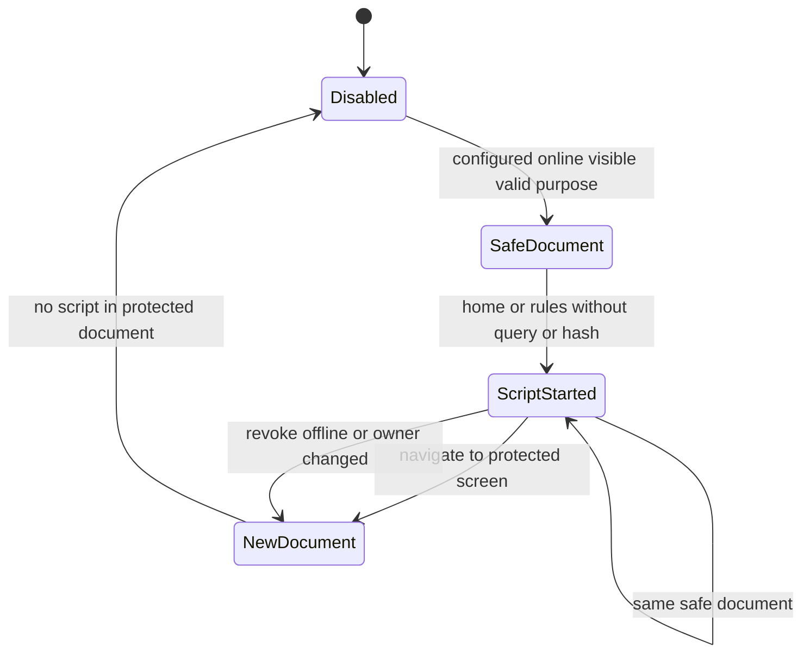

# 11. 광고·동의·정책 설계

> 2026-11-01 [ADR0081](../adr/0081-my-info-and-export-removal.md): 현재 동의의 본인 열람·재열기/철회는 내 정보와 공통 기기 설정으로 연결한다. 파일 다운로드와 동의 export 후속 계획은 제거한다. 로그인 없는 CMP 제어와 실제 CMP 미설정 차단은 유지한다.

> 대응: FR12/13 · 실제 광고 account ID·CMP·도메인 설정은 사용자 담당.

Google은 해당 지역의 맞춤형 광고 제공 시 Google 인증 CMP와 IAB TCF 통합을 요구한다. [Google 공식 요구사항](https://support.google.com/adsense/answer/13554116?hl=en)
본 제품은 EEA·영국·스위스뿐 아니라 지역 불명일 때도 비필수 광고/분석을 기본 차단하고 유효 선택 후 허용하는 보수적 구현을 제안한다. 인증이 모든 법적 의무 충족을 뜻하지는 않으며 공개 전에 실제 정책을 검토한다.

## 자동 광고와 문서 경계

2026-11-05 사용자 지시와 [ADR0091](../adr/0091-adsense-auto-ads.md)이 수동 결과 전면/3판 cap 설계를 대체한다. Google AdSense Auto ads가 배치와 노출을 결정하고 앱은 현재 광고 동의·허용 공개 문서에서만 script port를 시작한다. 실제 게시자ID/사이트 승인이 없으면 외부 광고를 요청하지 않는다. 자체 빈도 카운터·다중 탭 slot lock·H5/adBreak는 기본 범위에서 제외하며194 정책 구현은 후속에서 제거한다.

8locale 홈/규칙의 공개 문서만 초기 허용한다. 게임/튜토리얼/데일리/매칭/친구/순위·개인 결과/내정보/계정/설정/오류와 query/미허용hash 문서는 제외하고 고정 접근성 #main은 허용한다. 홈 첫방문 tutorial 전환도 제외한다. 광고 미설정/차단/실패는 게임/탐색에서 기다리지 않는다. ScriptPort는 configured/load(signal), 문서당 단1회·3초 기한·취소·자동재시도 없음으로 분리한다. 실제 설정은 AdSense 게시자ID이며 API키를 만들지 않는다.

script를 시작한 문서는 보호 화면으로 SPA 이동하기 전에 새 문서를 열어 실행 SDK를 격리한다. popstate/BFCache·철회/만료/계정 변경/오프라인을 재검사한다. 노드 삭제를 SDK unload로 간주하지 않는다. 초기 운영은 인페이지 자동 광고만 허용하고 overlay/vignette/anchor/side rail·ad intents는 끈다. 운영 page exclusions도 함께 검수한다. 상세 수명/실제한계·공식근거는 ADR0091을 따른다.

CMP의 필수 동의 처리와 광고 SDK를 분리한다. 분석 동의는 광고를 허용하지 않는다. 거부/오류/미설정에서는 게임을 정상 제공한다.8언어 공통 설정에서 동의를 재열거나 철회할 수 있다. 자동 광고의 script load를 실제 impression으로 기록하지 않는다.

## CSP와 문서

기본 default-src self, object-src none, base-uri self, frame-ancestors none, connect-src self+wss same origin. 광고용 script/frame/img/connect 도메인은 **선택한 CMP와 Google의 실제 통합 공식 요구사항·관측 결과**를 근거로 별도 allowlist 파일에서 관리한다. `*`나 전역 unsafe-inline으로 해결하지 않고 nonce/hash 호환성을 검증한다. report-only로 대표 흐름 확인 후 enforce한다.

8언어 개인정보·약관은 운영자/연락처, 처리 목적·법적 근거·보존·삭제, 쿠키/IndexedDB, Google/Cloudflare 이전, 동의/철회, OAuth 계정 연결/내 정보 조회/삭제, 미성년자 방침을 포함한다. 운영자 정보는 없는 값을 꾸며내지 않는다. `ads.txt`는 사용자 실제 publisher ID를 받은 뒤 작성하고 예시 ID를 배포하지 않는다. 광고 미승인 상태의 공개 베타는 무광고로 운영 가능하다.

#150 FR01/10/11/13·NFR01/02/06/07/08·TS18/19/24/26/31/35/36 → [ADR0070](../adr/0070-technical-storage-notice.md) → 읽기 전용8언어 실제 저장소/쿠키·footer/route/dialog·유지/삭제/메모리 대체 → [검증150](../verification/150-technical-storage-notice.md). 실제 CMP/전체 정책/외부147·상위21과83/141은 별도다.

#152 FR11/13·NFR01/02/06/07/08·TS19/24/26/29/31/36 → [ADR0071](../adr/0071-purpose-consent-port.md) → 목적별 닫힌 current CMP port/재열기수명·8언어설정·실행앱미설정차단 → [검증152](../verification/152-purpose-consent-port.md). 실제CMP/계정탭/서버동의·선택수집/외부147·상위21은후속이다.

#156 FR01/10/11/13·NFR01/02/05/06/07/08·TS18/19/20/24/26/29/31/35/36 → [ADR0073](../adr/0073-consent-context-and-expiry.md) → 메모리 현재 context/revision/만료·계정탭/복원 취소·시계/타이머 정리 → [검증156](../verification/156-consent-context-and-expiry.md). 실제 CMP/서버 proof/선택 수집·외부147/상위21은 후속이다.

#174 FR01/13/16·NFR01/02/05/07/08·TS20/21/24/29/31/35/36 → [ADR0080](../adr/0080-session-consent-authority.md) → 서버 검증 port/현재 세션·서버 revision CAS/목적별 철회·원자 권한/2초·실PG/삭제 cascade → [검증174](../verification/174-session-consent-authority.md). 현재 동의 조회는177/178에서 연결하며 파일 제공은 제거한다. 실제 CMP/선택 이벤트 저장·상위21과83은 별도 미완료다.

#182 FR01/13/16·NFR01/02/05/07/08·TS20/21/24/29/31/35/36 → [ADR0084](../adr/0084-bounded-consent-control-http.md) → 현재 cookie 세션의 동의 조회/서버 CAS 재검증·목적별/전체 철회 HTTP·기본 verifier 차단 → [검증182](../verification/182-consent-control-http.md). 선택 이벤트 at-write·실제 CMP/외부147·상위21은 후속이다.

#184 FR01/13/16·NFR01/02/05/07/08·TS20/21/22/24/29/31/35/36 → [ADR0085](../adr/0085-atomic-optional-event-storage.md) → 현재 세션/목적/revision의 같은 transaction 저장·별도 탭 상관키·불변 재시도·선택 raw30일/보존 → [검증184](../verification/184-optional-event-storage.md). 실제 CMP/공개 collector·외부147·상위21은 후속이다.

#186 FR01/13/16·NFR01/02/05/07/08·TS20/21/24/29/31/35/36 → [ADR0086](../adr/0086-consent-operation-deadline.md) → 동의 HTTP/전후세션/검증IO/두transaction의 동일 deadline·실제 backend 종료·공통 PG 기한 → [검증186](../verification/186-consent-operation-deadline.md). 실제 CMP/수집기·상위21/외부147·83은 후속이다.

#188 FR01/13/16·NFR01/02/05/07/08·TS20/21/22/24/29/31/35/36 → [ADR0087](../adr/0087-optional-event-http.md) → 폐쇄 단건/최소receipt·현재세션/같은transaction동의·원래기한/실제backend·실HTTPS → [검증188](../verification/188-optional-event-http.md). 실제CMP/브라우저자동수집·외부147·상위21/83은 후속이다.

#190 FR01/11/13/16·NFR01/02/05/06/07/08·TS19/20/21/22/24/26/29/31/35/36 → [ADR0088](../adr/0088-consent-and-event-client.md) → 현재self동의제어/화면·현재목적교집합/직전서버확인·단건취소/landing·Rust목적원천 → [검증190](../verification/190-consent-and-event-client.md). 실제CMP/광고·외부147/42·상위21/83은 후속이다.

#194 FR12/13·NFR01/02/05/07/08·TS23/24/25 → [ADR0090](../adr/0090-ad-request-policy.md) → Rust 화면/빈도·양쪽 제한/예약 계획·폐쇄 JSON/생성 TS·native/WASM → [검증194](../verification/194-ad-request-policy.md). 실제 잠금/저장·화면/SDK·상위22/21/147은 후속이다.

#196 FR12/13·NFR01/02/05/07/08·TS18/20/23/24/25/30 → [ADR0091](../adr/0091-adsense-auto-ads.md) → 사용자 자동광고 승인·3판/H5 대체·script port/공개문서/현재목적/게임 새문서 경계 → [검증196](../verification/196-auto-ads-design.md). 제품 구현과 실제 CMP/운영147·상위22/21은 후속이다.

#199 FR12/13·NFR01/02/05/07/08·TS18/20/23/24/25/30 → [ADR0091](../adr/0091-adsense-auto-ads.md) → 자동광고 script port/현재권한·공개/보호문서 경계·기본0/실제root·194미사용제거 → [검증199](../verification/199-auto-ads-runtime.md). 실제 CMP/Google운영147·상위22/21·83/198은 별도다.

#233 Google 공식 동의 메시지: [ADR0107](../adr/0107-google-cmp-bootstrap.md)·[사용자 선택](../workflow/approval-record.md). Google모드는 공개 문서에서 pause 설정→태그/CMP→현재 목적 선택→광고 허용시만 요청 재개한다. 태그를 읽은 모든 문서에 보호 화면 새 문서 경계를 적용한다. 승인 기록 병합 후 제품에서 구현하고, 미설정/거부/불명/오류 광고0·운영147 조건을 유지한다.
