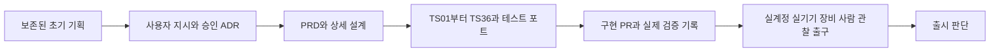

# 19. 초기 대비 설계 변경과 현행 계약

> 2026-11-21 · #241 · FR01~16, NFR01~08 · TS01~36. 기존 승인 결정의 정합성 검토이며 새 제품 범위나 승인 기록을 추가하지 않는다.

## 읽는 기준과 현재 단계

[브레인스토밍](../planning/01-brainstorm.md)은 선택지, [핸드오프](../planning/HANDOFF_PROMPT.md)는 초기 고정 조건과 작업 계획이다. 원문은 보존한다. 최신 사용자 지시와 [승인 기록](../workflow/approval-record.md), 승인된 PRD/설계/ADR을 기준으로 현재 요구를 읽는다. 아래 표의 구현 근거는 그 시점에 실행한 검사이며 이번 문서 작업에서 제품 검사를 다시 실행했다는 뜻은 아니다.

develop `be6156309adb1b028d241e0c43a9f641525cc99d`를 기준으로 코어·웹·네 제공자 어댑터·온라인/재접속·공식 데일리·내 정보·동의/광고 연결·PWA·배포/복구 도구가 병합돼 있다. **코드 병합과 공개 출시 검수는 별개다.** 아래 미완료 출구가 있어 M2~M6 전체 완료나 공개 준비 완료로 표시하지 않는다. GitHub 이슈 상태는 2026-11-21 조회 기준이다.

## 크게 달라지거나 구체화된 내용

| 영역 | 초기 내용 | 현행 계약과 변경 이유 | 근거 / 구현 증거 |
|---|---|---|---|
| 플랫폼·수익 | 브레인스토밍의 포털 유입·웹→유료 Steam/Tauri·DO 방 관리 | 핸드오프부터 자체 웹 PC/모바일·결제 없음·집 미니 PC/PostgreSQL/Tunnel로 확정. Steam·포털·DO는 채택하지 않음 | [비전](../product/01-vision.md), [ADR0003](../adr/0003-home-server-tunnel.md), [컨테이너 검증](../verification/211-isolated-container-deployment.md) |
| 온라인 비밀 | 브레인스토밍의 시드 전송으로 판 재현 | 온라인 seed/정답은 서버 전용. 공개 DTO만 전송. 공개 데일리·로컬 WASM의 재현과 분리 | [ADR0006](../adr/0006-server-authority.md), [프로토콜](06-protocol.md), [WS 검증](../verification/16-authoritative-match-actor.md) |
| 거짓말 공정성 | ±1 숫자 조작 뒤 모순을 찾는 일반 아이디어 | 모든 합법적 관측 세계에서 안전하게 열고 확정 지목해야 함. 임의 두 lie 모델의 완주 한계를 확인해 공개 이력으로 후보를 제한하는 `known-neighborhood-v1` 채택. 후보/예산 실패는 미적용·게이지 보존 | [ADR0007](../adr/0007-fairness-proof.md), [ADR0010](../adr/0010-public-certified-attack-strategy.md), [검증 #6과 한계](../verification/06-lie-certification.md) |
| 계정 | 초기 닉네임/게스트 중심 진입 | Google·Apple·카카오·네이버 필수, 확장 provider port. 온라인/공식 제출은 인증, 로컬 연습은 계정 생성 없음. subject digest·게임 닉네임만 저장하고 Apple 철회 credential은 목적 제한 암호화 예외 | [ADR0009](../adr/0009-oauth-minimal-identity.md), [17 인증](17-auth-privacy.md), [#44](../verification/44-oauth-providers-http.md)·[#45](../verification/45-account-rights-apple-revocation.md) |
| 본인 정보·공유 | 계정/게임 파일 export와 데일리 PNG | 내 정보·최근90일 전적·계정·동의를 웹에서 관리. 개인 파일 UI/API와 PNG 다운로드 제거. 웹 카드·복사/텍스트 공유 유지 | [ADR0081](../adr/0081-my-info-and-export-removal.md), [ADR0101](../adr/0101-web-workflows-and-installable-pwa.md), [#178](../verification/178-my-info-pages.md)·[#221](../verification/221-installable-pwa.md) |
| 데일리 신뢰 | UTC 같은 판·로컬 기록·결과 공유 | 첫 검증 완료를 고정. 서버 start/heartbeat가 검증된 시간 순위와 replay 완료/오류 순위를 구분. 로컬 시간은 공식 시간 아님. 현재 계정이 명시 제출하며 중복 재시도는 같은 결과 | [ADR0055](../adr/0055-bounded-daily-time-authority.md), [ADR0058](../adr/0058-public-daily-rankings.md), [#132](../verification/132-official-daily-flow.md) |
| 설치·오프라인 | 브라우저 캐시 연습 | 선택적 PWA 설치/메뉴 안내 추가. 설치해도 온라인 권한·공식 순위에는 연결 필요. 진행 판/결과 lease와 두 탭 업데이트 준비를 분리하고 ACK 전 입력 장벽 적용 | [ADR0101](../adr/0101-web-workflows-and-installable-pwa.md), [ADR0102](../adr/0102-update-interaction-barrier.md), [ADR0108](../adr/0108-full-viewport-update-interaction.md), [#83 대조](../verification/83-activation-recovery.md)·[#235](../verification/235-public-launch-wiring.md) |
| 광고 | 메뉴 배너·결과 전면·자체3판 제한/H5 | AdSense 자동 광고·교체 가능한 script로 전환. 자체 빈도/slot 정책 제거. 홈/규칙에서만 요청 허용, 게임·개인·인증은 새 문서로 격리 | [ADR0091](../adr/0091-adsense-auto-ads.md), [#199](../verification/199-auto-ads-runtime.md) |
| Google 동의 | 모든 광고 script를 동의 후 로드 | 명시 승인된 Google 모드만 공개 홈/규칙/동의 관리에서 태그를 먼저 준비하고 광고 요청 pause. 기존 Google 쿠키 읽기 가능성을 승인 기록에 명시. 현재 광고 선택 뒤 홈/규칙에서만 요청 재개 | [ADR0107](../adr/0107-google-cmp-bootstrap.md), [승인 기록](../workflow/approval-record.md), [#235](../verification/235-public-launch-wiring.md) |
| 자체 선택 수집 | CMP 여부를 하나의 허용값으로 취급할 위험 | Google 광고 허용과 서비스 분석/광고 측정을 분리. 현재 로그인에서 명시 반영한 bounded TCF 선택·서버 revision/만료·저장 transaction 재검사 필요. TC string은 Google 서명 증명이 아니며 저장/로그 제외 | [ADR0109](../adr/0109-current-session-google-consent-evidence.md), [11 동의](11-ads-consent.md), [#184](../verification/184-optional-event-storage.md)·[#235](../verification/235-public-launch-wiring.md) |
| 장애·복구 | dump 복원·이전 이미지로 rollback | 단일 journal owner·시작 시 중단 판 abort, 정상 종료 시 새 매칭 차단/기존 판 drain. 백업 복원 대상은 quarantine. 최신 삭제/연결 해제 원장 인증·비교와 원본 writer sealed 뒤에만 명시 재개 | [ADR0096](../adr/0096-online-shutdown-drain.md), [ADR0106](../adr/0106-controlled-recovery-resume.md), [#231](../verification/231-release-operations.md) |
| 개발·이름 | 초기 Next/Nest 코드·pnpm·Liar Sweeper | Rust/axum·Preact/Pixi 단일 규칙 구조, Yarn 4 workspace, 표시명 Liar Minesweeper. 기존 저장/운영 식별자와 원문 이력 보존 | [15 구조](15-repo-structure.md), [ADR0078](../adr/0078-yarn-workspace.md), [#237](../verification/237-liar-minesweeper-name.md) |

동일 판1:1·16×16/40·240초·최대 두 lie·봇의 관측 정보 제한·8언어·플레이 광고0·최소 수집·집 IP/DB/포트 비공개는 현행 불변 조건이다. 관전/GIF·코스메틱·랭크·배틀로얄·비대칭·유료 확장은 승인된 MVP 구현 범위에 넣지 않는다.

## 이번에 보강한 누락과 충돌

| 발견한 문제 | 보강 위치와 의미 |
|---|---|
| 결정이 append 이력에만 쌓여 현재 단계·초기 대비 차이를 읽기 어려움 | 이 문서와 [문서 안내](../README.md)에 현행 변경표·공개 출구를 연결. 기존 ADR/검증 원문은 보존 |
| 시스템 컨텍스트에 OAuth 제공자와 Google 태그/보호 문서 경계 누락 | [01 구조](01-architecture.md)에 제공자·서버 교환·공개/보호 문서 경계를 추가 |
| 광고 본문/상태도가 동의 전 태그0을 요구해 승인된 Google bootstrap과 충돌 | [11 광고](11-ads-consent.md)에 태그 시작과 광고 요청 허용을 별도 상태로 명시 |
| 복원 뒤 바로 ready로 가는 초기 설명이 삭제·철회 정보를 되살릴 위험 | [16 운영](16-observability-ops.md)과 [복구 절차](../workflow/recovery-quarantine.md)에 quarantine→최신 원장/원본 차단→보존 정리→명시 재개를 연결. 원본/최신 자료 없는 자동 재개 금지 |
| PRD·구조·DB·배포의 미래형, 문서 안내의 ADR0037 상한, 수동 병합 대기 설명 | 현재 구현/검증 근거로 갱신. M0 당시 승인 대기·제품0줄·과거 export/3판 정책은 이력임을 명시 |
| #83 미완료 문구와 현재 CLOSED 상태 불일치 | 현재 추적은 #83 수정/종료와 #235 후속 viewport 보강을 함께 읽고, 실제 기기 설치/갱신 출구는 #223으로 분리 |

## 요구 → 시나리오 → 실제 경계 → 남은 출구

아래는 [전체 추적표](00-review-checklist.md)를 보완하는 변경 영역의 요약이다. 기존 TS 번호와 인수 조건을 유지한다.

| 요구 | 시나리오 | 설계 / 검증 경계 | 남은 GitHub 출구와 완료 증거 |
|---|---|---|---|
| FR01/14/16, NFR02 | TS01/15/16/20/29/31~36 | [17 인증](17-auth-privacy.md)·AuthService/provider·실DB/HTTPS/WS | [#42](https://github.com/crystal23733/search-mine/issues/42)·부모#15 OPEN: 네 실제 제공자 최소 권한 로그인/연결/삭제·Apple 철회/알림 |
| FR08/10/11, NFR06 | TS13/18/19/20/24/26/30/36 | [08 client](08-client-architecture.md)·InstallPort/업데이트 장벽·실제 worker/browser | [#223](https://github.com/crystal23733/search-mine/issues/223) OPEN: 실제 OS/기기 설치·독립 실행·업데이트/오프라인·OAuth 왕복. [#23](https://github.com/crystal23733/search-mine/issues/23) OPEN: 번역/키보드/화면낭독기 최종 검수 |
| FR12/13/16, NFR02 | TS20/23/24/25/29/31/35 | [11 광고](11-ads-consent.md)·Google shared client/TCF·현재 세션/동일 transaction 수집 | [#147](https://github.com/crystal23733/search-mine/issues/147)·부모#21/#22 OPEN: 운영자8언어 정책·실제 게시자/CMP 메시지·거부/철회/네트워크/CSP·ads.txt 검수 |
| FR14/16, NFR07 | TS15/16/20/21/28/29/31/35 | [16 운영](16-observability-ops.md)·main/drain/내부 CLI·암호화 백업/원장·격리DB | [#24](https://github.com/crystal23733/search-mine/issues/24)·[#25](https://github.com/crystal23733/search-mine/issues/25) OPEN: 실제 Tunnel/회선/호스트·별도 매체/키·이전 이미지·삭제 비복원·실측 RPO/RTO |
| NFR03/04/07 | TS21/26/27/28 | [13 성능](13-performance.md)·release 부하/번들 도구 | [#26](https://github.com/crystal23733/search-mine/issues/26) OPEN: 미니 PC 사양/표본/내부 p95·글로벌 RTT·실기기 LCP/FPS·안정 용량70% admission |
| FR04/06/08/15/16 | TS07/11/13/27/29 | [05 알고리즘](05-algorithms.md)·관측 증명/봇·E1/E2 관찰 | [#27](https://github.com/crystal23733/search-mine/issues/27) OPEN: 사람의30초 이해·재대결·공정성 인식/튜닝. 코어 반례 검사가 재미 성공을 뜻하지 않음 |
| FR12/16 | TS23/29 | [수익 가정](../product/07-monetization.md)·지표/정산/전력 관찰 | [#28](https://github.com/crystal23733/search-mine/issues/28) OPEN: 실제28일 수입/비용·표본·동의 편향. 예상 수익표는 실적 아님 |

## 남은 판단과 유지 원칙

필수 OAuth·정책·복구/용량·기기 검수를 문서 작성만으로 닫지 않는다. 광고 없는 공개 가능성도 계정·정책·공정성·운영 출구를 생략하는 근거가 아니다. 운영자 실행 순서와 증거 제출은 [출시 체크리스트](../workflow/launch-checklist.md), 비밀 외 입력은 [외부 입력](../workflow/external-inputs.md)을 따른다.

초기 번들/성능 수치는 목표이며 실제 장비·측정 창·빌드가 없는 성적을 추가하지 않는다. 규칙/범위 변경이 필요해지면 별도 설계/ADR과 사용자 판단을 거친다. 이번 검토에서 새 모드·결제·호스팅 전환을 채택하거나 기존 approval JSON을 변경하지 않는다.
