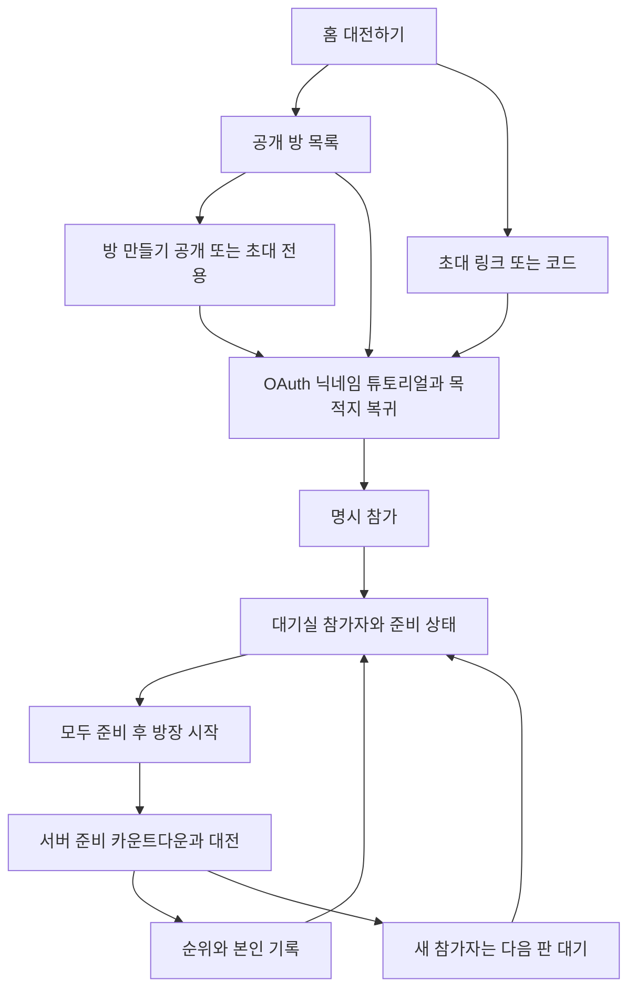
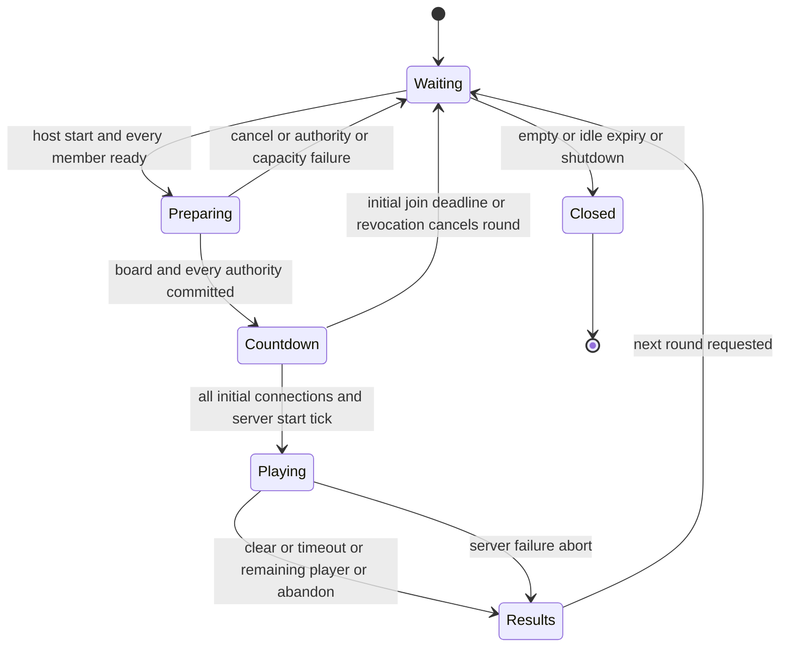
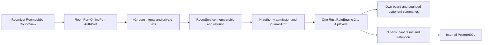

# 20. 공개·초대 방과 2~4인 개인전

> 2026-11-21 · #243/#244 · [ADR0110](../adr/0110-multiplayer-rooms-and-rankings.md). 사용자가 인원·승리·순위·공격 방식을 명시했다. 설계 기록 먼저 병합 후 제품 작업을 시작한다. 아래 새 계약은 구현 완료를 뜻하지 않는다.

## 사용자 기준과 현재 상태

| 영역 | 현재 develop의 구현 | 이번 확장 계약 |
|---|---|---|
| 빠른 대전 | FIFO로 사람1명 또는10초 뒤 표시된 봇과1:1 | 그대로 유지. 다인전 빠른 참가는 공개 대기 방에 명시 참가하는 별도 조작 |
| 친구 방 | 8문자 코드/링크·두 자리·각자 ready 후 서버 시작 | 공개/초대 전용·정원2/3/4명·방장 시작·같은 방 반복 |
| 발견 | 받은 코드로 직접 참가 | 방 목록에서 인원/정원/상태를 보고 참가하거나 직접 생성 |
| 대전 | 단일 상대·개인별 동일 판·공격/간파·240초 | 동일 코어의2~4개 개인 판·무작위 상대 공격·N인 순위 |
| 재대결 | 결과에서 초기 로비 흐름으로 돌아감 | 결과 확인 후 방 membership을 유지하고 모두 다시 준비 |

현재 근거는 [#72](../verification/72-friends-room-ui.md), `lobby/policy.rs`의2seat/ready, `game.rs`의 두 Player/Seat.other, `online/state.rs`의2인 projection/result 배열이다. 화면의 정원만 바꿔 다인전을 완료한 것으로 하지 않는다.

공식 조사에서 방 목록/초대/준비·시작·반복 흐름을 참고했다. 다른 게임의 최대 인원이나 인기를 우리 성능·성공 근거로 사용하지 않는다. [조사와 확인 한계](../research/2026-11-21-multiplayer-room-flows.md).

## 이용 흐름과 화면

- 홈은 방 찾기·방 만들기·초대 참가를 제공하고 기존 빠른1:1·봇/데일리로도 진입할 수 있다. 다른 사람과 하는 방법을 한 화면에서 설명한다.
- `/{locale}/rooms`: 공개 방 카드에 평문 방 이름·현재 인원/정원·대기/준비/진행 상태·고정 규칙을 표시한다. 로딩/빈 목록/만석/서비스 제한/오류를 구분하고 새로고침·새 방 만들기를 제공한다. 참가 가능 방을 우선 보여준다.
- 방 생성: 이름(2~32 grapheme 평문, 기본 방장 닉네임 기반)·공개/초대 전용·정원2/3/4(기본4). 지뢰/시간/공격 수치를 임의 편집하는 규칙 빌더는 만들지 않는다.
- `/{locale}/rooms/{room_id}`: 참가자 게임 닉네임·본인/방장·준비·정원·규칙·초대 코드/링크·나가기·방장 설정/추방·시작을 보여준다. 공석을 봇으로 표시하지 않는다.
- 초대는 로그인 전 입력에 보존하고 로그인/닉네임/튜토리얼 후 원래 방 참가 화면으로 돌아온다. 링크 방문만으로 참가·기존 방 이탈을 실행하지 않는다. 만료/닫힘이면 이유와 목록 복귀를 제공한다.
- 웹의 `/rooms`는 공개 목록을 비로그인 상태에서도 읽되 참가·변경에는 현재 인증 증명을 사용한다. 초대코드는 해당 경로와 명시적인 로그인·닉네임·튜토리얼 복귀 흐름에서만 유지한다. 브라우저 주소에 경기 ID를 저장하지 않고 현재 방 조회 결과의 라운드 ID로 Socket을 연결한다.
- 방 목록은 로그인 없이 조회 가능하다. 실제 방 참가/생성/준비/시작은 OAuth·닉네임을 요구한다. 비공개 방은 목록·검색·sitemap에 노출하지 않는다.
- 대전은 본인 보드 하나를 크게, 나머지 최대3명은 닉네임·연 안전칸 수·연결/기절 상태 카드로 표시한다. 타인 셀/숫자/깃발·실시간 공격 성공/수신 지점은 표시하지 않는다. 공격 버튼은 수동 대상 선택 없이 기존 게이지를 사용한다.
- 결과는 전체 순위와 본인 세부 기록·같은 방으로·나가기를 제공한다. 파일 다운로드는 없다. 뒤늦게 확인한 결과가 이미 시작된 다음 판을 덮지 못하도록 room/round identity를 확인한다.

## 방과 라운드의 상태·권한

- room_id와 room_revision, round_id와 generation은 별개다. 계정은 기존 큐/방/준비/실행 대전 중 한 membership만 가진다. 방 안 실행 중 대전은 같은 membership의 round binding이다.
- 모든 변경은 예상 room_revision·현재 account/session authority·role을 확인한다. 같은 요청 ID 재전송은 동일 결과이며 다른 payload는 충돌이다. 오래된 poll/명령/보드 준비 응답을 폐기한다.
- 대기에서 참여 인원2명 이상, 모든 실제 참가자의 ready, 방장 start를 모두 요구한다. 정원을 꽉 채울 필요는 없다. 단순 ready로 자동 시작하지 않는다. 구성/정원/공개 여부/입퇴장 변화는 준비 상태를 초기화한다.
- start는 roster/규칙/hash를 고정한 reservation을 만들고 N명의 세션/철회 상태·자원 수용량을 다시 확인한다. lock 밖 보드 준비 뒤 같은 generation을 재검사하고 journal ACK와 registry commit 뒤에만 match_id를 공개한다. 준비 실패는 방으로 돌아가 원인을 표시한다.
- 준비/countdown 취소·최초 연결 실패는 경기 전 취소이며 승패/정상 완료로 기록하지 않는다. playing의 이탈/철회는 개인 forfeit 정책을 적용한다. 방장이 나가도 다른 사람의 진행 중 판을 중단하지 않는다.
- 방장은 대기에서 설정 변경/추방/시작만 가능하다. 진행 판의 입력/시드/기절/승패를 변경하지 못한다. 방장 이탈은 가장 오래 남은 유효 참가자에게 승계한다. 역할 변화는 revision을 올린다.
- 대기 중 추방은 해당 room incarnation 동안 재입장을 막는다. bounded deny 목록·운영자 rate를 적용하고 추방 대상은 현재 방의 seat/revision으로 검증한다. 진행 중 임의 추방으로 순위를 바꾸지 않는다.
- 진행 중 새 참가자는 정원 여유가 있을 때 다음 판 대기 상태로만 입장한다. 현재 round의 좌석/roster/권한은 고정이며 떠난 사람의 round seat를 새 사람에게 주지 않는다. 만석이면 대기열을 무한히 만들지 않고 full을 알린다.
- 결과에서 방을 유지하며 각자의 재대결 준비를 다시 받는다. 이전 ready/입력 UUID/epoch는 새 판으로 이월하지 않는다. 새 round_id·새 private board·새 countdown을 사용한다.
- idle 만료는 마지막 유효 사용자 조작 이후 기존10분이다. 상태 poll은 연장하지 않으며 실행 중 판은 idle 만료로 자르지 않는다. 빈 방은 즉시 닫고 초대 코드를 무효화한다. 서버 재시작은 방을 닫고 저장된 진행 판을 기존 장애 규칙으로 abort한다. 방이 디스크에서 복구된다고 약속하지 않는다.

## 2~4인 규칙과 순위

모든 참가자는 같은 Board/zero opening/규칙 snapshot을 사용하되 PlayerBoard·flag·knowledge·gauge·기절·입력 cursor는 분리한다. 기존16×16/40·240초·3초/2초 기절·게이지20·max_lies2·30초 유예를 바꾸지 않는다. 지뢰/오지목이 생명 소진이나 탈락을 뜻하지 않는다.

1. 서버 ingress 시각을 기준으로 명령을 직렬 적용한다. 같은 시각에 처리 대기 중인 입력 묶음은 좌석과 입력 순번으로 정렬한다. 먼저 commit된 완주자가1위다. 해당 전이 시점에 전원 상태를 고정하고 남은 입력을 종료 뒤 거절한다.
2. 정상 참여자 중 완주자 외 순위는 고정된 opened_safe 내림차순이다. 지뢰·깃발은 칸 수에 넣지 않으며 부동소수점 진행률로 비교하지 않는다. 동점은 공동 순위(예:1,2,2,4)다. 실수/지목/클릭 수를 숨은 타이브레이크로 쓰지 않는다. 드문 시작 opening 자체의 전원 동시 완주는 기존처럼 공동1위로 처리한다.
3. 시간 만료면 생존 정상 참여자 모두를 같은 칸 수 기준으로 순위화한다. 최대값 동점은 공동1위이며 `winner`를 한 사람으로 추측하지 않는다. 시각이 deadline 이상인 입력은 판정 후 거절한다.
4. 명시 포기·세션 철회·재연결 유예 만료는 DNF로 분리하고 정상 순위 뒤에 이탈로 표시한다. 이탈 전 칸 수가 커도 정상 완주자/남은 사람을 이기지 않는다. 유예 동안은 시간 계속·복귀 가능이며 만료 전까지 임의 봇으로 바꾸지 않는다.
5. 한 명만 남으면 기존 forfeit 승리로 종료한다. 같은 서버 tick에서 모든 유예가 만료되면 먼저 전체 만료 집합을 구한 뒤 abandoned로 처리해 좌석 순서가 우승자를 만들지 않게 한다. 장애/불명 abort는 정상 순위/승패에 넣지 않고 본인 수치를 모르면 null로 둔다.
6. 기존2인 v1/local의 승패/공개 DTO와 의미를 유지한다. 새 N인 결과는 room_id/round_id·mode·정원/실참가 수·본인 rank/tied·결과 사유를 구분한다. 순위는 core 결과를 소비하며 TS/SQL에서 다시 판정하지 않는다.

## 무작위 공격과 간파·반사

- 공격 시 자신·DNF를 제외한 해당 round 참가자 중 한 명을 서버에서 균등 추첨한다. 연결 유예 중인 상대는 아직 참가자다. 보드 생성과 분리된 private RandomSource를 주입하고 편향 없는 bounded draw를 사용한다. 공격자는 대상·숫자·좌표를 명령에 넣지 않는다.
- 무작위 대상 한 명에 기존 known-neighborhood-v1 후보/안전 간파 증명을 적용한다. 후보 없음·두 lie 상한·stale/예산 실패면 미적용·게이지 보존이다. 같은 공격에서 다른 사람을 순회하며 성공할 때까지 재추첨하지 않는다. 이는 모든 시도의 무작위 선정이며 성공한 공격이 모든 사람에게 같은 수로 전달된다는 보장은 아니다.
- overlay 최대2는 **피격자 한 사람의 합계**이며 공격자마다2개가 아니다. A/B/C의 동시 공격도 서버가 직렬 검증하고3번째 성공을 허용하지 않는다. 각 후보는 그 피격자의 관측/기존 overlay 합성 상태로 검증한다.
- overlay는 원래 source seat를 보존한다. C가 B에게 받은 lie를 지목하면 B만 게이지0/2초 기절이며 다른 임의 참가자에게 반사하지 않는다. 공격자가 이미 이탈해도 숫자 복원은 적용하고 이탈을 되돌리지는 않는다.
- 같은 command 재전송은 같은 추첨/ACK를 재사용한다. 새로운 epoch의 재전송도 원래 효과를 다시 만들지 않는다. 게이지 부족/기절/종료 등 사전 거절은 추첨하지 않는다. source/대상/후보와 RNG state를 public DTO·로그·client storage에 넣지 않는다.
- 추첨/명령 소비는 직렬 actor/core 전이 경계에서 확정한다. 증명 worker의 늦은 응답은 피격자 observation_revision·round generation을 재검사한다. 공격 성공 시각/피격자 표시가 간파 힌트가 되지 않게 기존 projection 비밀 경계를 유지한다.

## 구조·프로토콜·저장 경계

- RoomPolicy는 title/visibility/capacity/membership/ready/host/round binding을 담당하고 Board·SQL·socket을 알지 않는다. RoomService가 Auth/BoardPool/Registry/Journal 포트를 조합한다.
- RuleEngine/PreparedEngine의 bounded player 집합을 일반화하고 상대 하나를 뜻하는 필드는 별도 v1 adapter로 격리한다. 공유 셀/게이지/지목 코드를 복제한 별도 다인전 엔진은 만들지 않는다. 무작위 공격은 deterministic test source로 검사한다.
- v2의 방 좌석과 경기 좌석은 별도다. 방 좌석은 대기실 구성원에게 배정하고, 경기 좌석은 시작 예약의 참가 순서를 기준으로 고정한다. 방에 중간 참가한 사람에게는 현재 경기 좌석이 없다. 현재 방을 조회하거나 입장할 때 식별자와 단조 revision을 사용한다.
- 방 도메인은 시각과 서명된 세션 대신 이미 확인된 내부 계정과 닉네임을 받아 상태를 전이한다. HTTP의 세션·Origin·CSRF, 동일 요청 ID 캐시, 기존 빠른 대전과 공유하는 단일 점유, 시작 권한 재검사와 journal ACK는 #247의 실행 계층에서 연결한다.
- 시작의 최종 권한 검사는 기존 서버의 철회 잠금 아래 고정된 참가자 전원에게 적용한다. 같은 계정, 교체·철회·만료된 세션, 이 registry에서 발급하지 않은 권한이 하나라도 있으면 입장 commit 전체를 중단한다. 보드 계산과 DB 요청은 권한 잠금 밖에서 수행한다.
- 기존 빠른 대전과 다인 방의 점유는 같은 서버 로비 잠금과 설정된 참가자 상한을 공유한다. 다인 방 변경의 요청 ID·응답은 현재 세션에 묶어 2분간 제한된 메모리에 둔다. 재전송 시 효과를 반복하지 않고, 이미 방에서 빠진 계정에는 예전 초대 코드나 방 상태를 다시 보내지 않는다.
- 새 Rust v2 room intent에는 list/status/create/join/leave/ready/configure/start/kick을 둔다. list는 public bounded metadata, 나머지는 현재 세션/Origin/CSRF·room revision을 확인한다. v1 `/api/v1/lobby`와 기존 초대 링크는 지원을 유지한다. 새 경로/버전을 조용히 v1으로 축소하지 않는다.
- `POST /api/v2/rooms`는 같은 출처의 목록 요청에서 세션을 읽지 않는다. 방 가입과 변경은 현재 쿠키·CSRF를 확인한다. `/api/v2/ws`는 같은 인증 경계에서 예약 계정의 라운드에 연결한다. 두 경로 모두 응답을 캐시하지 않고 쿼리 문자열로 초대 코드나 인증을 받지 않는다.
- v2 WS는 같은 인증 경계에서 own board 하나와 opponents 최대3개·본인 cursor·round/result revision을 보낸다. roster는 round-scoped seat와 게임 닉네임만 표시하고 내부 account UUID/provider digest는 공개하지 않는다. 초대 코드는 seat credential이 아니며 HTTP/WS 로그에서 제거한다.
- v2 입력에는 현재 라운드 ID, 명령 ID, 순번, 연결 epoch, 마지막 관측 revision, 기존 게임 조작을 넣는다. 가능한 모든 조작을 같은 인증 연결에서 검증하며, 송신자 좌석·공격 대상·시각은 본문에서 받지 않는다. 초기 연결을 기다릴 때는 참가 인원만 알리고, 연결된 참가자에게는 자신의 판과 상대 요약을 보낸다.
- 영속 결과·active journal은 participant 행/집합을 N명으로 저장하고 실제 start_at/보존 기준·유일성·권리 삭제·단일 writer·abort를 유지한다. 기존 migration/checksum과90일 기록은 보존하고 forward migration을 추가한다. 닉네임/프로필을 결과 JSON에 새로 복사하지 않는다.
- 방 라운드의 journal은 room ID, 확정 인원, 최초 시작 확인 시각을 추가로 기록한다. 기존 대전의 기본 인원은 2명이다. 좌석은 해당 행의 확정 인원 미만으로 제한한다. 진행한 라운드의 보존 기준은 시작 확인 시각이며 미시작 장애는 입장 시각을 쓴다. 저장할 때 공동 순위 여부를 확정하여 참가자 삭제 후에도 순위·공동 여부·원래 인원을 복원하거나 다시 계산할 필요가 없다.
- 본인 내 정보에 참여 인원·순위/공동순위·종료 사유를 추가한다. 같은 방 동료의 결과는 해당 round 참가자에게 공개된 최소 순위만 제공하고 타인의 상세 전적·셀/replay를 노출하지 않는다. 계정 삭제 후 익명 자리 표지를 사용하되 과거 순위를 재계산하지 않는다.
- 결과 상태인 방을 새로고침하면 현 라운드 참가자에게 저장 상태와 같은 순위를 다시 보낸다. 방을 떠나거나 세션을 잃은 사람의 별칭은 해당 결과에서 익명으로 표시한다. 다음 판 대기 참가자와 공개 목록에는 비교 순위를 보내지 않는다.
- 내 정보의 다인전 행에는 본인의 확정 인원·순위·공동 여부·이탈 여부만 추가한다. 참가자의 계정과 초대 코드, 비공개 판을 조회하지 않는다. v1 대전 직후 복구용 결과 검색은 기존 빠른 대전과 봇 기록을 대상으로 하고, 다인전의 보존 기간은 원래 시작 시각을 기준으로 적용한다.
- 필수 대전 이벤트는 N명에 대해 같은 결과 transaction으로 한 번 수집한다. 기존 자체 선택 동의·Google 광고 선택/개인정보/보존 계약을 바꾸지 않는다.

## 수용량·보안·화면과 복구

- 정원2~4는 게임 규칙 상한이지 서버 전체 동접 보장이 아니다. 기존 matches/connections/proof workers/board pool/authority 상한을 유지하고 시작 시 N석 전량을 예약한다.4인을 받아 둔 뒤 물리 연결32 상한 때문에 일부만 시작시키지 않는다.
- 경기 예약 단계에서 기존 대전과 공유하는 경기 슬롯 하나와 모든 물리 연결 자리를 확보한다. 필요한 자리 수를 확보할 수 없으면 계정 점유를 추가하지 않는다. 취소나 준비 실패 시 예약이 소유한 자리와 점유를 반환한다.
- 라운드 연결은 예약에서 고정된 로그인 세션과 좌석을 확인한다. 카운트다운 마감 전에 모든 좌석이 연결되고 방 및 세션이 유효해야 경기 시작을 저장한다. 초기 연결 실패는 예약을 취소한다. 경기 중 전송 끊김은 재접속 유예를 주고, 명시 이탈과 권한 철회는 이탈로 처리한다.
- 공개 목록은 최대20개/응답, cursor로 명시 더보기, 입력2KiB/응답32KiB/전체2초·별도 global/동일 출처 rate를 적용한다. 방 이름/인원/상태/opaque ID 외 IP/세션/비공개 코드/내부 host identity를 반환하지 않는다. 짧은 평문은 NFC·grapheme/제어·방향 제어 문자 정책과 HTML escaping을 적용한다.
- 목록 자동 갱신은 전경5초, 대기실은 전경1초를 기준으로 중복 요청 없이 수행하고 숨김/오프라인에서 멈춘다. 사용자 변경 시 poll을 중단하고 전후 authority/room identity를 확인한다. 실제 부하는 #26에서 측정하고 초과 시 서버 admission으로 제한한다.
- 대전 actor·증명·송신은 bounded다. 타인 전체 셀을 매번 보내는 N제곱 보드 전송은 하지 않는다. slow client·중복 연결·N명 동시 철회/종료/저장 실패를 실제 WS/PG에서 검증한다.
- 새 rooms/round 경로는 개인/게임 문서다. 광고 태그가 준비된 문서에서 새 문서로 탐색하고 로비·준비·진행·결과 모두 광고0을 유지한다. sitemap/SEO 공개 방 수집과 SW의 참가자/온라인 응답 캐시는 금지한다.
- 8언어·360/390px·키보드·screen reader·reduced motion에서 방 상태/준비/본인/방장/공동 순위를 텍스트로 식별한다. 모바일은 본인 보드와 좁은 상대 요약 목록을 제공하며4개 보드를 축소해 읽게 하지 않는다.
- 갱신/나가기 중 API 취소가 성공했다고 낙관 표시하지 않는다. 새로고침은 인증된 내 membership으로 복구하며 브라우저 영속 저장에 새 계정/라운드/seed를 넣지 않는다. PWA 갱신은 기존 준비 ACK/입력 장벽·결과 lease를 유지한다.
- 같은 세션에서 두 탭을 열면 이미 연결된 탭이 좌석의 소켓 자리를 유지한다. 다른 탭은 판을 표시하거나 입력을 받지 않는다. 기존 연결이 끊기면 접속 유예 안에 새 탭에서 같은 라운드를 복구할 수 있다.

## 추적·순차 구현과 출구

FR17 방 경험·FR18 다인 순위/무작위 공격, 기존 FR01~16/NFR01~08과 TS37~45를 따른다. 구현 순서는 백로그의 **설계 → Rust 코어/규칙/순위 → v2 DTO/방 정책 → 권위 서버/저장/복구 → 공개 HTTP/WS → 8언어 웹/호환 → 전체 통합**이다. 각 단계는 시나리오 Red 실행→Green→리뷰→checks→PR 병합·이슈 종료 뒤 다음으로 넘어간다.

필수 출구: 2/3/4인 같은 판, 첫 완주 순간 순위 고정/동점, 무작위 대상·original source 반사·세번째 lie 거절·dedup, 모집/정원/만석/시작 race·새 참가 대기,4인 WS/실DB·장애 abort·삭제/90일 유지,8언어 PC/모바일·초대 OAuth·PWA·광고0, 기존1:1/봇/데일리 회귀다. 설계 문법 검사만으로 이 출구를 통과했다고 표시하지 않는다.

## 결정 사항과 남은 확인

사용자 선택으로2~4인·기존 레이스·첫 완주 종료·안전칸 수 순위·무작위 상대 공격을 확정했다. 공동 순위/명시 준비·시작/진행 중 다음 판 대기 등은 위의 구체 계약으로 검증한다. 숫자 조작/간파·반사가 핵심 차별화 가설이며 사용자 확보를 보장하지 않는다.

실제 OAuth/CMP/호스트 설정과 도메인은 #42/#147/#24, 실제 장비 동접/회선은 #26, 사람의 공정성·재대결 평가는 #27, 실제 OS 설치는 #223이다. 기존 외부 출구를 다인전 구현 완료로 닫지 않는다.
