# 21. 시스템 흐름과 데이터 관계

[PRD](../product/16-PRD.md)의 사용자 흐름부터 실제 API, 저장소, 운영까지 연결한다. 각 그림에서 생략한 제약과 예외 처리는 연결된 상세 설계와 검증 문서를 따른다. 다인전은 [통합 검증 #249](../verification/249-multiplayer-integration.md)까지 반영한다.

[전체 구조](#전체-구조와-배포) · [사용자 여정](#사용자-여정) · [OAuth](#oauth-로그인과-계정) · [온라인 대전](#온라인-대전) · [데일리](#데일리와-오프라인) · [동의](#광고와-자체-수집-동의) · [ERD](#postgresql-erd) · [운영](#기동-백업-부하-확인)

## 전체 구조와 배포

현행 배포 설계는 홈 미니 PC를 사용한다. Oracle 서울 VM은 같은 Docker Compose를 옮겨 실행하는 **검토 후보**다. 호스팅 선정과 실제 용량 검수는 [#24](https://github.com/crystal23733/search-mine/issues/24)와 [#26](https://github.com/crystal23733/search-mine/issues/26)에 남는다.

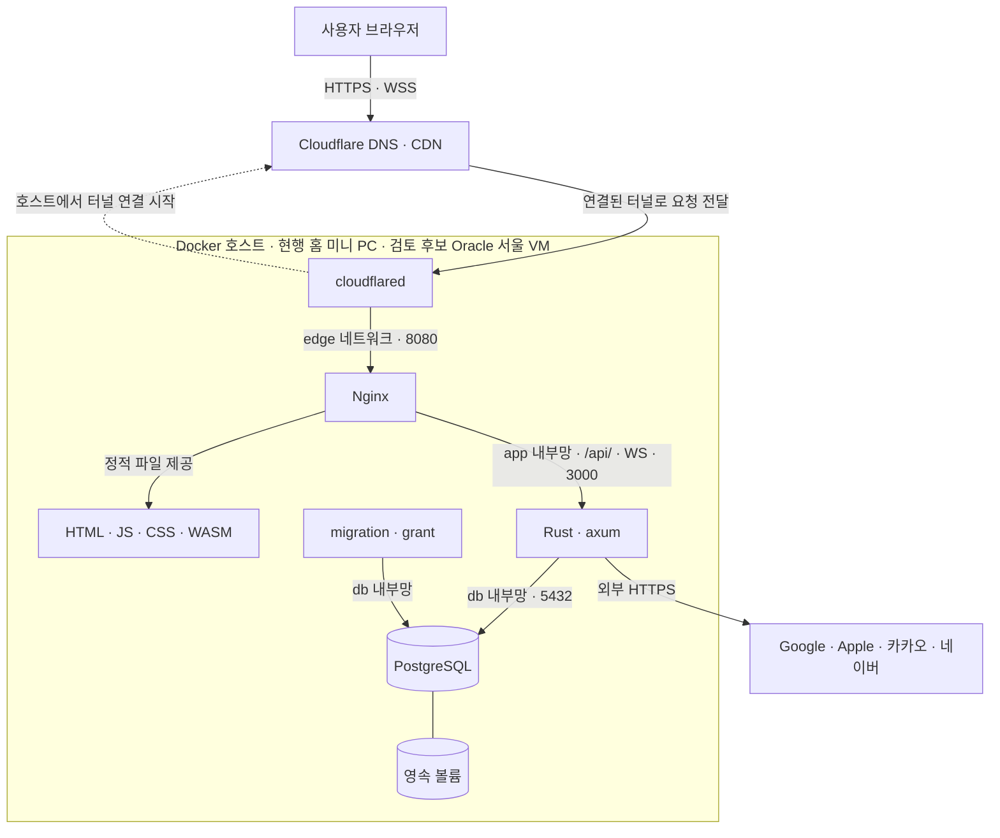

게임·DB 포트는 호스트에 공개하지 않는다. Cloudflare에 캐시된 정적 자산은 엣지에서 응답하고 인증·API·WebSocket은 원본을 거친다. [배포·네트워크](02-deployment-network.md) · [Compose](../../deploy/compose.yml)

### 규칙과 의존성

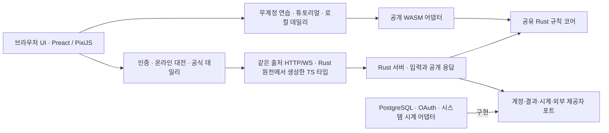

온라인 비공개 시드와 지뢰 위치는 서버 안에 둔다. 클라이언트는 본인에게 공개된 보드 상태와 상대 요약으로 화면을 그린다. [구조](01-architecture.md) · [규칙](04-game-rules-spec.md) · [프로토콜](06-protocol.md) · [클라이언트 구조](08-client-architecture.md)

## 사용자 여정

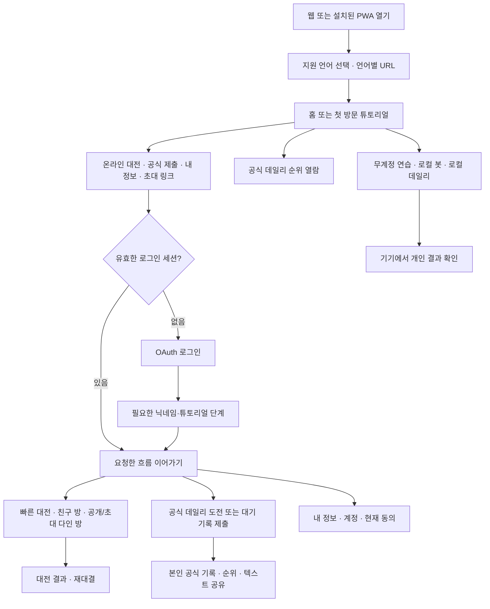

[화면·키보드·터치 흐름](09-screens-ux.md) · [8언어 URL](10-i18n.md) · [PWA 설치](../workflow/pwa-installation.md)

## OAuth 로그인과 계정

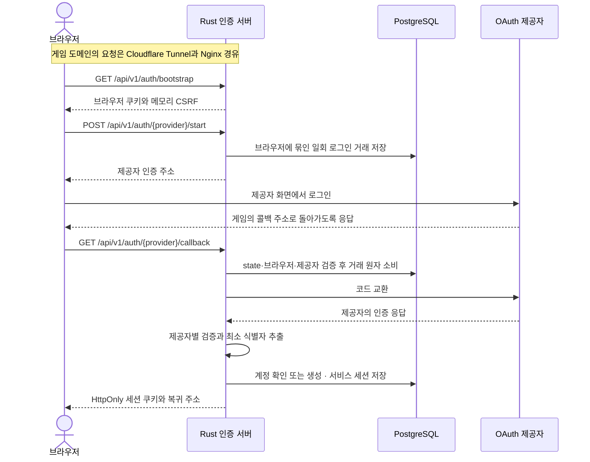

계정 연결·해제와 삭제는 본인 인증·최근 재인증을 거친다. Apple 철회용 자격 증명은 암호화해 보관한다. 앱의 실제 제공자 설정과 실계정 확인은 [#42](https://github.com/crystal23733/search-mine/issues/42)에 남는다. [인증·개인정보](17-auth-privacy.md) · [OAuth HTTP 검증](../verification/44-oauth-providers-http.md)

## 온라인 대전

### 1:1 빠른 대전과 친구 방

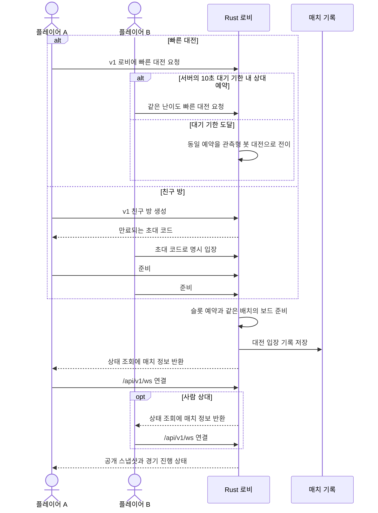

[빠른 대전 화면·실제 WS](../verification/70-online-quick-match-ui.md) · [친구 방·OAuth 초대 복귀](../verification/72-friends-room-ui.md)

### 2~4인 방과 라운드

아래는 4명이 정상적으로 한 판을 끝내는 경로다. 시작 시 경기 슬롯 하나와 참가자 전원의 연결 자리를 예약한다. 진행 중 여석으로 들어온 멤버는 다음 판을 기다린다.

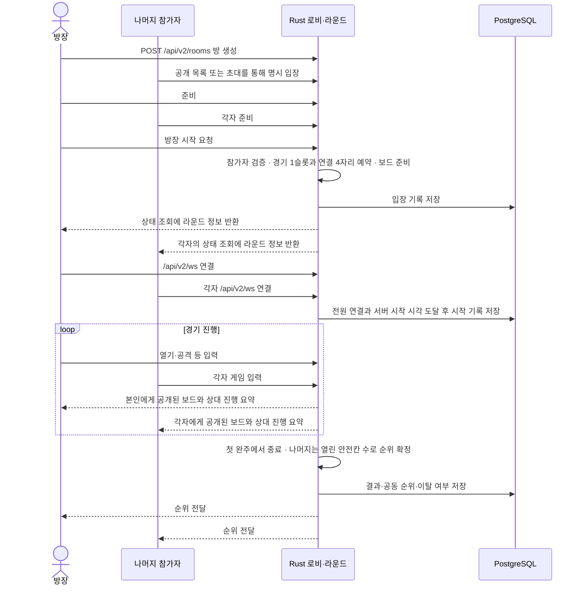

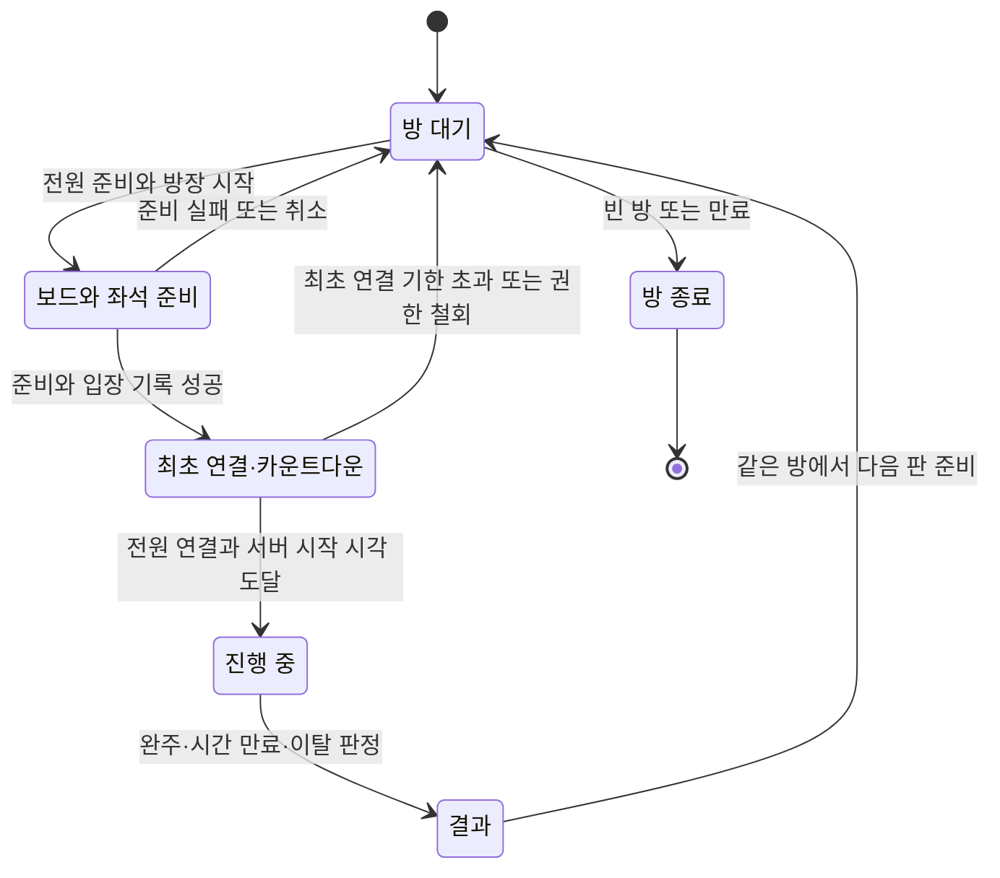

공격 대상은 서버가 무작위로 고르고 성공한 지목은 원래 공격자에게 반사한다. 재대결은 같은 방에 새 라운드와 새 보드를 만든다. 서버 재시작 시 메모리의 방은 닫히며, 영속 입장 기록은 장애 판정에 사용한다. [다인전 상세](20-multiplayer-rooms.md) · [4명 공격·재대결 검증](../verification/249-multiplayer-integration.md)

### 권위 입력과 재접속

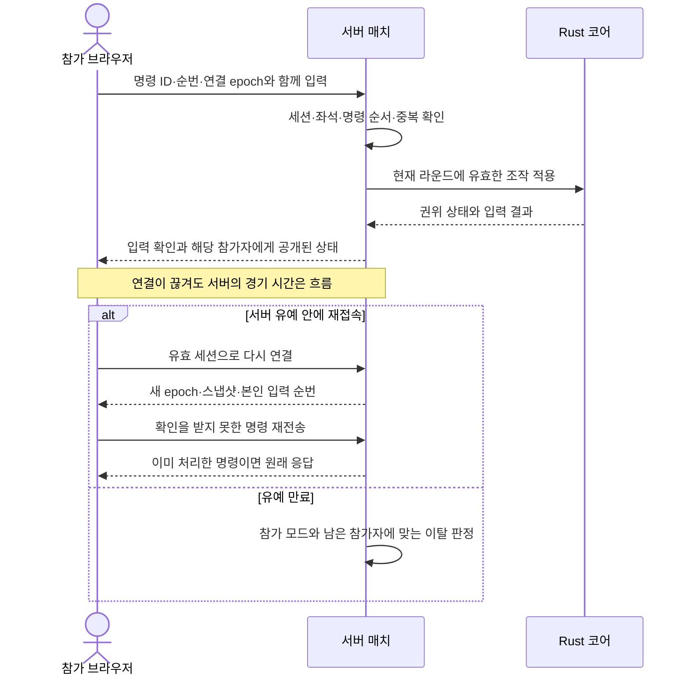

[WebSocket 계약](06-protocol.md) · [자동 재접속](../verification/80-bounded-online-reconnect.md) · [연결 종료·재시작 검증](../verification/107-reconnect-integration-exit.md)

## 데일리와 오프라인

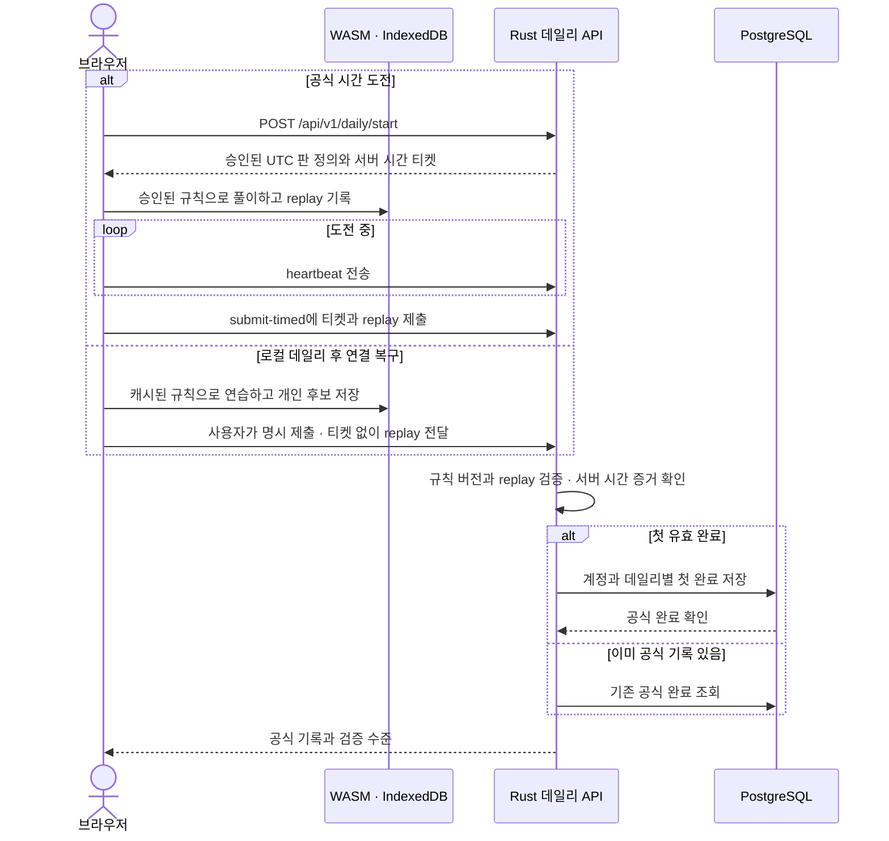

서버 시간 증거가 유효할 때 시간 순위에 들어가며, 완료만 검증한 기록은 완료·오류 순위로 확인할 수 있다. 개인 기록과 제출 대기는 별도로 유지한다. [공식 데일리 화면과 서버 검증](../verification/132-official-daily-flow.md) · [공개 순위](../adr/0058-public-daily-rankings.md)

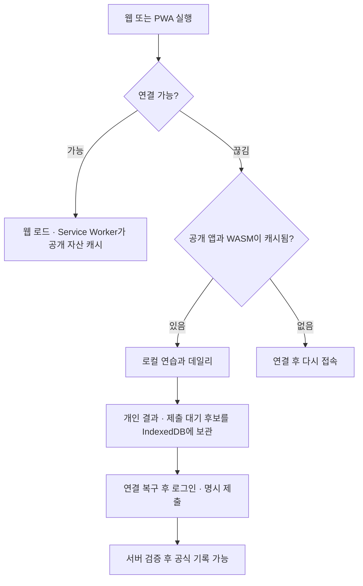

세션·개인 API·광고 응답은 Service Worker에 캐시하지 않는다. [브라우저 저장소와 오프라인 경계](08-client-architecture.md#오프라인-경계) · [오프라인 검증](../verification/14-public-offline-cache.md)

## 광고와 자체 수집 동의

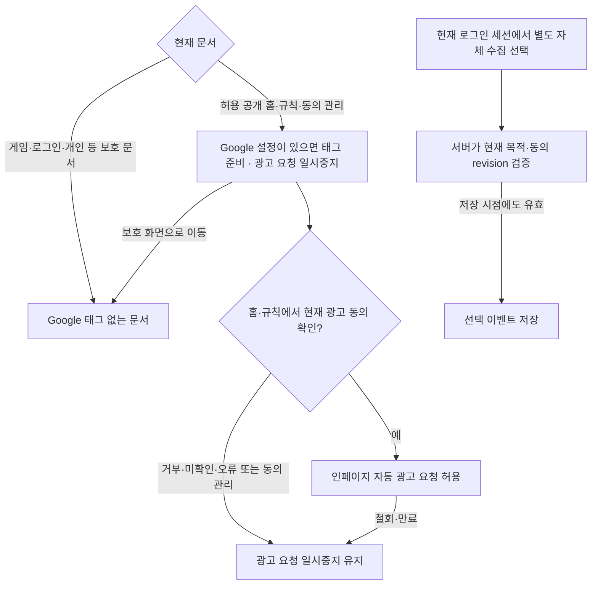

Google 광고 선택과 자체 수집 선택은 별개다. 보호 화면으로 갈 때 Google 태그를 시작한 문서에서 새 문서로 이동한다. 광고가 비활성이거나 실패해도 게임이 진행된다. [광고·동의 설계](11-ads-consent.md) · [공개 문서와 보호 문서 검증](../verification/235-public-launch-wiring.md)

## PostgreSQL ERD

현재 [마이그레이션](../../migrations)의 테이블 이름과 물리 FK를 사용한다. 관계와 주요 제약을 읽는 데 필요한 컬럼을 표시한다. 실선은 자식의 기본 키에 부모 키가 포함되는 관계이며, FK가 nullable인 경우 부모 쪽의 선택성을 표시한다.

### 계정·인증·동의

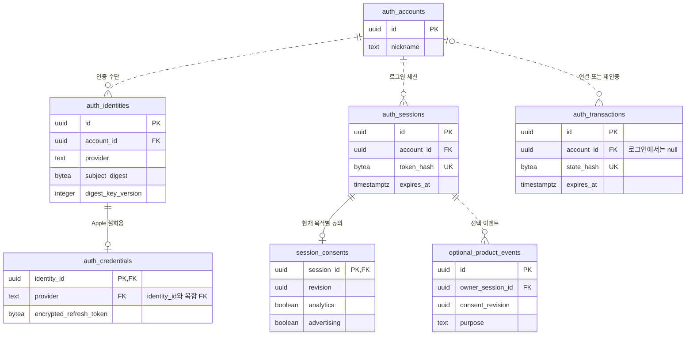

선택 이벤트는 **세션**에 연결된다. `consent_revision`은 당시 저장에 사용한 값이며 현재 동의 행과의 FK는 없다. [인증 DDL](../../migrations/202610080001_auth_foundation.sql) · [동의 DDL](../../migrations/202611010001_session_consents.sql) · [선택 이벤트 DDL](../../migrations/202611030001_optional_product_events.sql)

### 온라인 대전·데일리·필수 이벤트

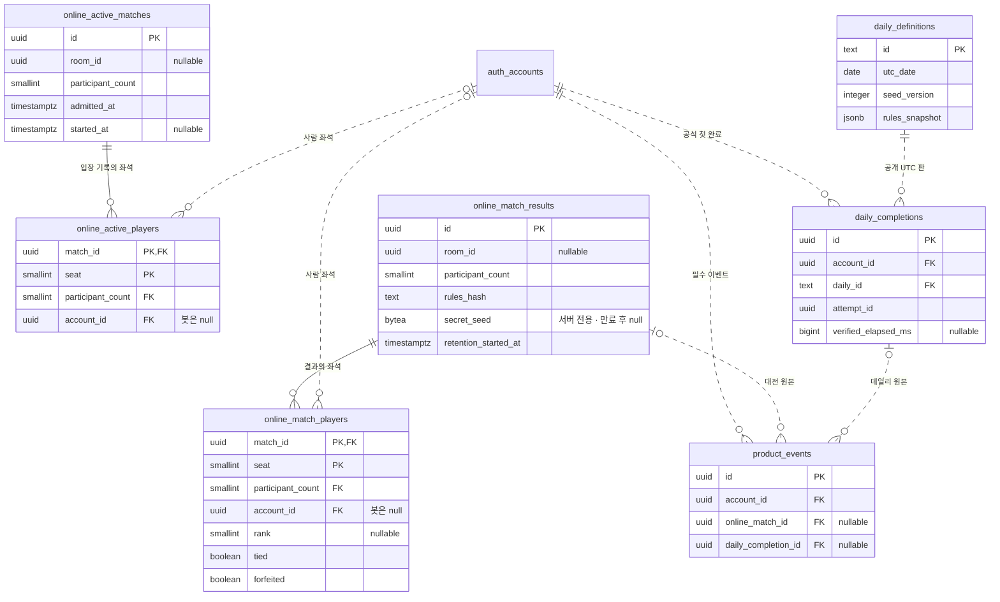

- 두 참가자 테이블의 PK는 각각 `(match_id, seat)`이고 `(match_id, participant_count)`가 부모의 `(id, participant_count)`와 맞아야 한다. `room_id`는 서버 메모리의 방 식별자다. 계정 삭제는 사람의 참가 행을 제거한다.
- 데일리는 `(account_id, daily_id)`로 첫 기록을 한 건 유지한다. 필수 이벤트는 대전 결과와 데일리 완료 중 하나만 원본으로 참조한다.
- 원시 필수 이벤트를 집계한 `product_metric_aggregates`는 `(metric, period)`로 저장하며 사용자나 이벤트 FK가 없다. 복구 제어·원본 식별과 삭제 원장은 [복구 스키마와 절차](../workflow/recovery-quarantine.md)를 따른다.

[다인전 결과 DDL](../../migrations/202611220001_multiplayer_race_results.sql) · [데일리 최초 완료 DDL](../../migrations/202610110001_daily_first_completion.sql) · [필수 이벤트 DDL](../../migrations/202610150001_essential_product_events.sql)

### 데이터 보존과 삭제

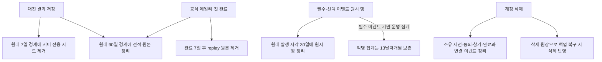

복구가 원래 보존 기한을 늘리지 않도록 원본 시작·완료 시각을 사용한다. 계정 삭제 뒤에는 식별할 수 없는 대전 부모 행과 익명 집계가 각 보존 정책에 따라 남을 수 있다. [원본 정리 검증](../verification/215-source-retention.md) · [익명 지표 보존 검증](../verification/145-anonymous-metrics-retention-and-operations.md)

## 기동, 백업, 부하 확인

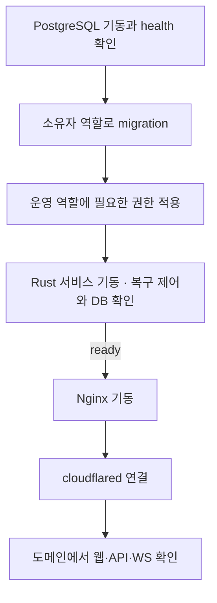

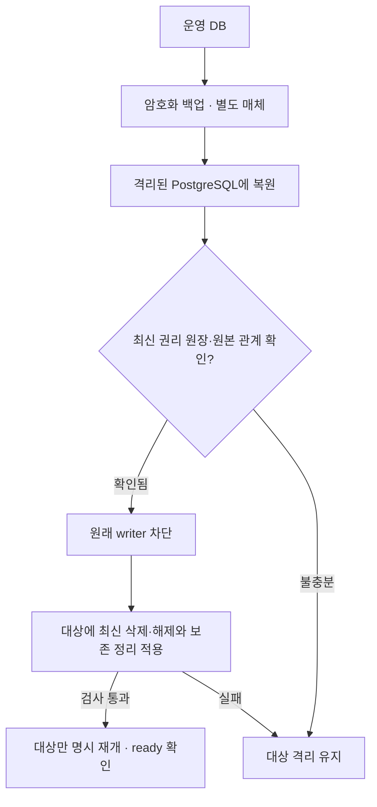

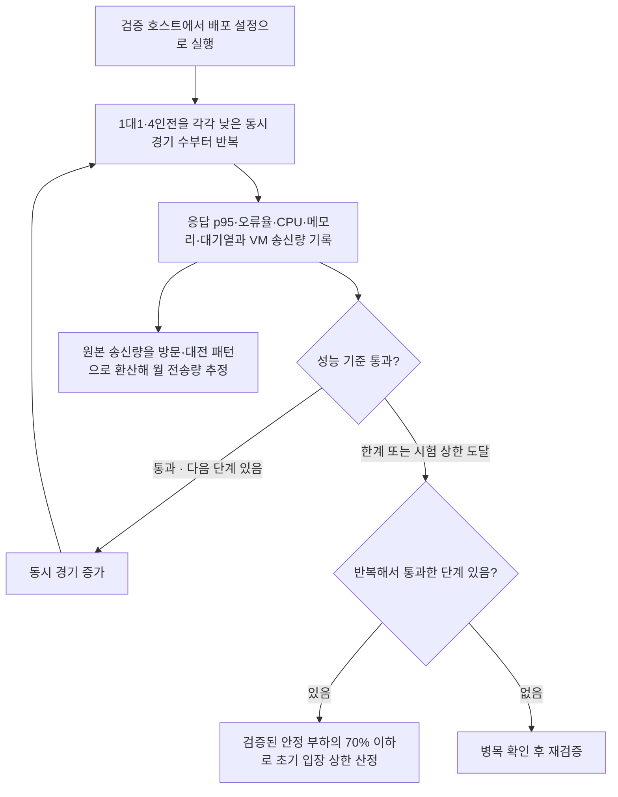

Compose 기본값은 경기 16슬롯·WebSocket 32개다. 이 값은 호스트의 검증된 성능 수치와 별도로 표시한다. 1대1 부하 도구와 4인 통합 검증은 각각 존재하며, Oracle 또는 실제 운영 장비의 4인 부하 검증은 별도다. [기동·종료 절차](../workflow/container-deployment.md) · [격리 복구](16-observability-ops.md) · [성능 기준](13-performance.md) · [부하 도구](../workflow/release-operations.md)

## 요구와 검증 연결

| 그림 | 대표 요구와 시나리오 | 검증 근거 |
|---|---|---|
| 구조·사용자 여정 | FR08/10/11 · NFR01/02/06 · TS13/18/19/22/26/30/36 | [로컬 연습](../verification/12-local-practice-tutorial.md) · [PWA](../verification/221-installable-pwa.md) |
| OAuth·계정·동의 | FR01/12/13/16 · NFR02 · TS01/20/23~25/29/31~36 | [계정 권리](../verification/45-account-rights-apple-revocation.md) · [내 정보](../verification/178-my-info-pages.md) · [Google 연결](../verification/235-public-launch-wiring.md) |
| 온라인 대전·재접속 | FR02~07/14/15/17/18 · NFR02 · TS02~12/14~16/21/22/27/37~45 | [거짓말 인증](../verification/06-lie-certification.md) · [1:1](../verification/70-online-quick-match-ui.md) · [4인](../verification/249-multiplayer-integration.md) |
| 데일리·오프라인 | FR09/10 · TS17/18/36 | [공식 데일리](../verification/132-official-daily-flow.md) · [오프라인](../verification/14-public-offline-cache.md) |
| PostgreSQL·운영 | FR16/18 · NFR03/04/05/07/08 · TS21/27~30/35/43/45 | [보존](../verification/215-source-retention.md) · [격리 배포](../verification/211-isolated-container-deployment.md) · [운영 도구](../verification/231-release-operations.md) |

[전체 요구 추적표](00-review-checklist.md) · [시나리오](../product/19-test-scenarios.md) · [Git 검토·병합 규칙](../workflow/git-workflow.md)
